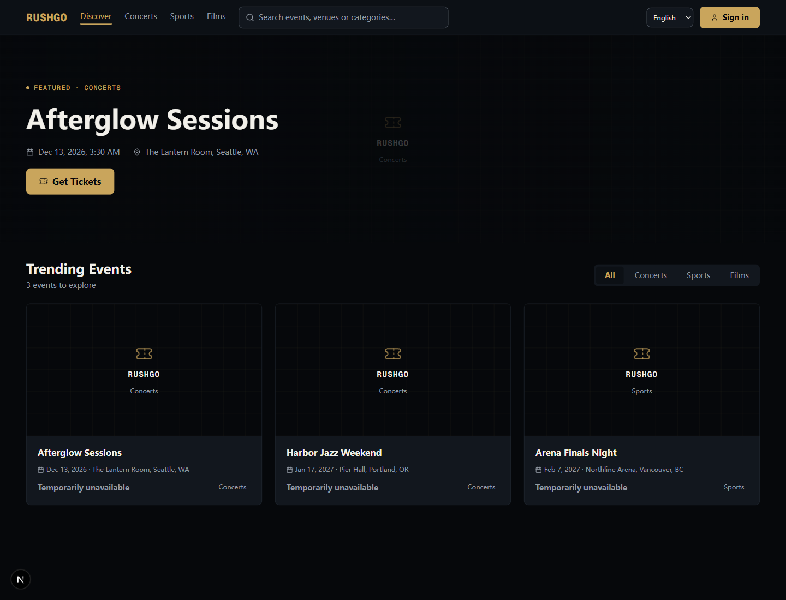

# RushGo Local Demo

[简体中文](DEMO.md) | [English](DEMO.en.md)

Mode A lets you try event search and category filters in your browser. Mode B previews customer, staff, and admin pages or regenerates the page gallery. Both use the real Next.js pages with local sample data. Neither requires Docker, Go, an account, or payment credentials. To connect the frontend to the full service stack, follow the [backend development guide](backend/README.en.md) and [frontend configuration guide](frontend/README.en.md).

## Start the read-only discovery demo

From a checkout of the repository, open two PowerShell windows. The verified Windows setup used Node.js 24.11.1 and npm 11.7.0. The first `npm ci` needs access to the package registry to download the versions pinned in the lockfile. Check that `node --version` and `npm --version` work, and that ports `8765` and `3000` are available.

**Window 1** starts the read-only sample API. Leave it running.

```powershell
node .\docs\demo\events-api.mjs
```

**Window 2** installs the frontend dependencies, points the Next.js API URL at the first window, and starts the frontend.

```powershell
cd frontend
npm ci
$env:NEXT_PUBLIC_API_URL = "http://127.0.0.1:8765"
npm run dev -- --hostname 127.0.0.1 --port 3000
```

When Next.js is ready, open <http://127.0.0.1:3000/>. Event details, accounts, booking, payment, ticket issuance, refunds, and admin operations require additional APIs. This demo covers homepage search and category filtering.

## Try the discovery page

| Action | Expected result |
| --- | --- |
| Open the homepage | The list contains Afterglow Sessions, Harbor Jazz Weekend, and Arena Finals Night. |
| Enter `Harbor` in the search box and press Enter | Only Harbor Jazz Weekend remains. |
| Clear the search and select `Sports` | Only Arena Finals Night remains. Select `Concerts` to see two music events. |
| Keep the `Harbor` search and select `Sports` | Both filters apply and the result is empty. |

In another PowerShell window, check the HTTP responses before and after they pass through the browser's API proxy. The first command should return `3`, and the second should return `Harbor Jazz Weekend`.

```powershell
(Invoke-RestMethod 'http://127.0.0.1:8765/api/events').total
(Invoke-RestMethod 'http://127.0.0.1:3000/api/events?search=Harbor').events.title
```



The [sample API](docs/demo/events-api.mjs) listens only on the local machine and provides `GET /api/features` and `GET /api/events`. Dates, locations, and prices for all three events are sample values. Sales are paused and ticket-tier inventory is zero.

## Stop the discovery demo

Press `Ctrl+C` in both windows. Before reusing the second window in the same PowerShell session, remove the environment variable set for this demo.

```powershell
Remove-Item Env:NEXT_PUBLIC_API_URL -ErrorAction SilentlyContinue
```

## Multi-page preview and screenshots

Mode B uses a single PowerShell window. Start at the repository root and use a local checkout without business credentials. `127.0.0.1:1` is a placeholder API address for this fixture build. The preview tool opens the browser itself. **Do not open this port as a website.** Playwright is included in the frontend lockfile. On Windows, use an installed Microsoft Edge or run `npx playwright install chromium` from `frontend` to install a compatible browser.

```powershell
cd frontend
npm ci
$env:NEXT_PUBLIC_API_URL = "http://127.0.0.1:1"
npm run build
cd ..
```

**Open a page for interactive viewing.** Run one command at a time. Close the preview window before starting another. The script sets up separate synthetic buyer and administrator identities for the seat-selection and admin pages and fills in sample IDs. Each preview runs in an isolated browser context with a dynamically assigned local port.

```powershell
node .\docs\demo\capture-gallery.mjs --preview '/events/[id]/seats'
node .\docs\demo\capture-gallery.mjs --preview '/admin/events'
```

**Regenerate the gallery.** From the same repository root, run the command below. The script captures desktop and selected mobile PNGs for each route, updates the gallery and JSON index, and exits. Rebuild the frontend after changing it, and capture from a clean frontend checkout. See the [screenshots directory](docs/demo/screenshots), [complete page gallery](docs/SCREENSHOTS.en.md), and [per-image index](docs/demo/screenshot-index.json).

```powershell
node .\docs\demo\capture-gallery.mjs
node .\docs\check-docs.mjs --fix-gallery-nav
Remove-Item Env:NEXT_PUBLIC_API_URL -ErrorAction SilentlyContinue
```

After regenerating the images, run `node .\docs\check-docs.mjs --fix-gallery-nav` to restore the top-of-file bilingual navigation and validate documentation links. It does not overwrite the hand-translated English. If you only opened a preview, close the window and run the final environment-variable cleanup command as well.

The `--preview` option accepts a route template from the gallery. The browser blocks external requests and business write operations. The checkout-resume response is supplied only inside the browser as a fixed order snapshot. The seat-selection page receives a local SSE ready event. The preview does not submit sign-ins, check-ins, or approvals, create real transactions, or send email. The screenshots show the RushGo interface in Simplified Chinese. [Capture script](docs/demo/capture-gallery.mjs) · [Verification scope](PROJECT_STATUS.en.md)

## Troubleshooting

- **A port is already in use.** Check whether the sample API is already running. The script fixes its port at `8765`. If only the frontend port is busy, change `--port 3000` to `--port 3001` and use `3001` in the browser and HTTP-check URLs.
- **The API returns events, but the homepage is empty.** Clear the search and category filters, then run the two HTTP checks above. Set the API URL in the same window that starts Next.js, use only the service base URL without `/api` at the end, and restart the frontend.
- **The preview cannot find a build or browser.** From `frontend`, run `npm ci` and `npm run build`. If there is no compatible Chromium or Edge installed, run `npx playwright install chromium` from that directory and try again.
