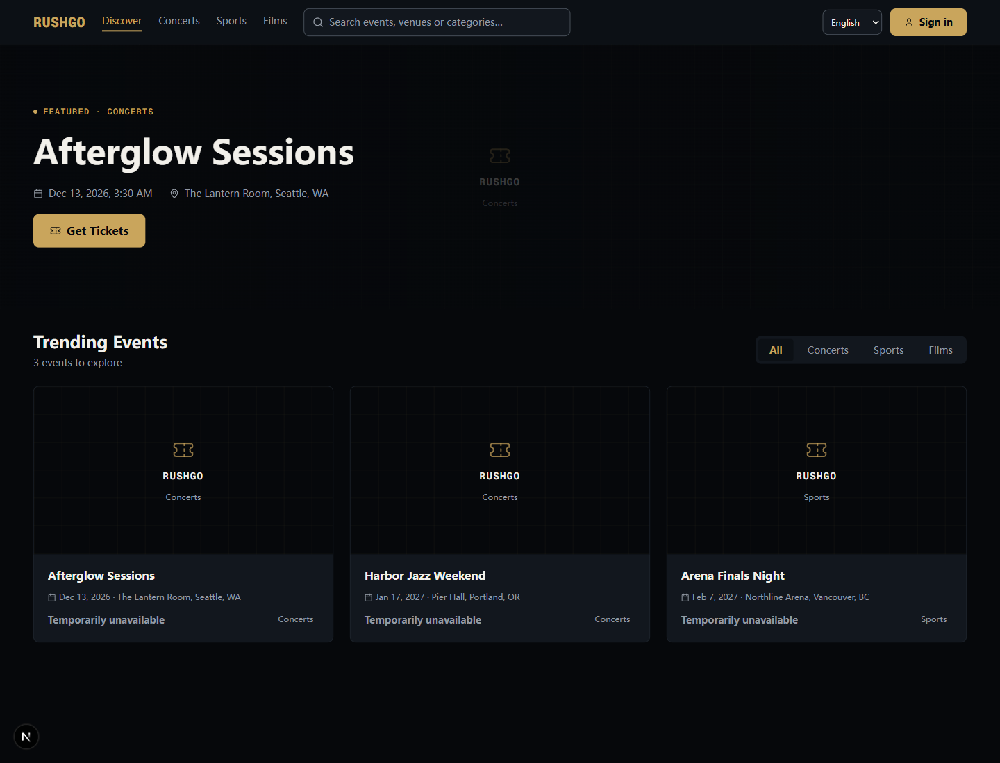

# RushGo 本地演示

用两个本地进程即可查看 RushGo 首页，体验活动搜索和分类。Next.js 渲染真实页面，Node.js 样例 API 提供三个虚构活动。演示无需登录、数据库、Docker 或支付密钥。

## 启动只读发现页

准备 PowerShell、Node.js 和 npm。本地复核使用 Node.js 24，首次运行 `npm ci` 需要能从 npm 源取得锁文件指定的依赖。确保本机端口 `8765` 和 `3000` 可用。

在仓库根目录打开两个 PowerShell 窗口。在第一个窗口启动样例 API。

```powershell
node .\docs\demo\events-api.mjs
```

在第二个窗口安装锁定版本的前端依赖，将 API 指向样例服务，然后启动 Next.js。

```powershell
cd frontend
npm ci
$env:NEXT_PUBLIC_API_URL = "http://127.0.0.1:8765"
npm run dev -- --hostname 127.0.0.1 --port 3000
```

看到 Next.js 就绪后，打开 <http://127.0.0.1:3000/>。

## 在发现页试一遍

| 操作 | 预期结果 |
| --- | --- |
| 打开首页 | 活动列表有 Afterglow Sessions、Harbor Jazz Weekend 和 Arena Finals Night。 |
| 在顶部搜索框输入 `Harbor`，按 Enter | 列表仅显示 Harbor Jazz Weekend。搜索还可以匹配描述、场馆和地点。 |
| 清空搜索后选择 `Sports` | 列表仅显示 Arena Finals Night。选择 `Concerts` 可看到两场音乐活动。 |
| 保留 `Harbor` 搜索并选择 `Sports` | 两个条件一起生效，结果为空；清除搜索后会显示体育活动。 |



[样例脚本](docs/demo/events-api.mjs)只监听本机回环地址，提供 `GET /api/features` 和 `GET /api/events`。活动日期、地点和金额都是展示数据，销售已暂停，票档库存为零。活动详情、账户、选座、下单、支付、出票、退款和通知都需要其他接口。完整服务的依赖见[后端说明](backend/README.md)，验证范围见[项目状态](PROJECT_STATUS.md)。

## 常见问题

- **首页能打开，但没有预期的活动。** 先清空搜索并返回首页，再打开 <http://127.0.0.1:8765/api/events>。默认响应应包含三个活动。如果直接请求成功，再检查 <http://127.0.0.1:3000/api/events> 是否返回同一列表。
- **样例 API 正常，前端仍连到其他地址。** 在启动 Next.js 的同一窗口设置 `NEXT_PUBLIC_API_URL`，并重启前端。变量只填服务地址，不加 `/api`；[Next.js 配置](frontend/next.config.ts)会拼接接口路径。
- **提示端口已占用。** 样例脚本固定监听 `8765`，先确认是否已经启动过。如果 `3000` 已被其他应用使用，可把前端命令的 `--port 3000` 改为 `--port 3001`，再打开 <http://127.0.0.1:3001/>。
- **打开活动详情后看不到数据。** 样例接口只提供列表和功能开关。返回首页即可继续体验筛选。

## 停止发现页演示

在两个 PowerShell 窗口分别按 `Ctrl+C`。若要在同一窗口改连其他后端，先运行 `Remove-Item Env:NEXT_PUBLIC_API_URL` 清除本次会话的演示地址，再按目标环境配置前端。

## 多页面预览与截图

[页面图册](docs/SCREENSHOTS.md)使用另一个独立入口。真实前端从本地构建加载，浏览器按路由读取预置的活动、订单和管理数据。截图脚本自行启动回环地址上的临时服务，使用独立浏览器上下文和合成身份。无需启动上面的两个窗口。

在仓库根目录的 PowerShell 中准备前端生产构建。这里的 API 地址是本机未提供业务服务的端口，截图数据由脚本提供。请使用未配置支付密钥的本地检出。

```powershell
cd frontend
npm ci
$env:NEXT_PUBLIC_API_URL = "http://127.0.0.1:1"
npm run build
cd ..
```

脚本使用前端锁文件中的 Playwright。Windows 上有 Microsoft Edge 时可直接使用；其他环境可在 `frontend` 目录运行 `npx playwright install chromium` 准备匹配的浏览器。在仓库根目录运行下列任一命令。

```powershell
# 生成桌面和手机截图、页面图册及 JSON 索引
node .\docs\demo\capture-gallery.mjs

# 打开一个可查看的页面；关闭浏览器窗口即结束
node .\docs\demo\capture-gallery.mjs --preview '/events/[id]/seats'
```

`--preview` 接受图册中的路由模板，脚本会填入对应样例 ID 并选择演示身份。每次修改前端后应重新构建。图片保存在 [screenshots](docs/demo/screenshots)，逐图的路由、角色、视口、前端源码版本及生成入口见[截图索引](docs/demo/screenshot-index.json)。

API 写请求和外部网络请求均被拦截。结账页读取预置的待处理订单，恢复接口的响应只在浏览器内返回；不会创建订单、加载外部支付表单或发送邮件。选座页使用本机的就绪事件和座位快照。登录、核销、签发凭证、退款审批等表单可查看，截图流程不提交这些操作。
