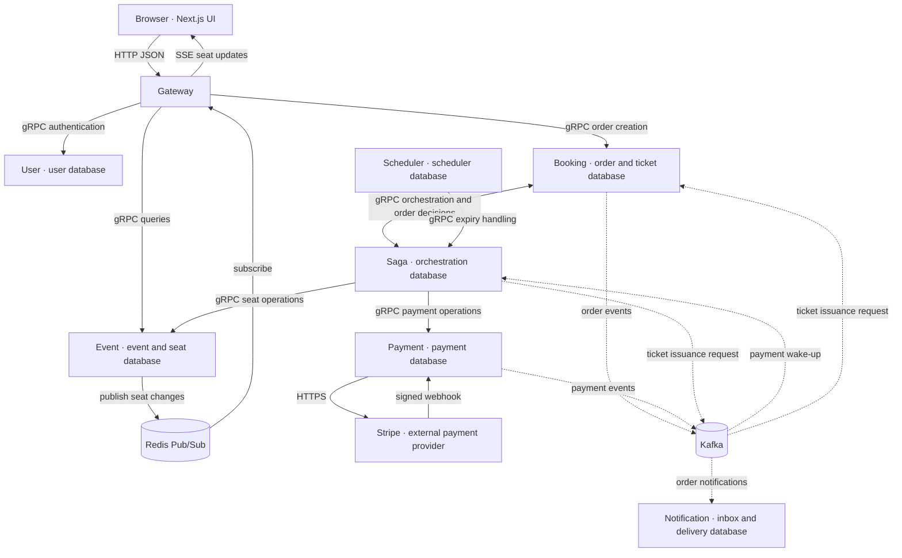
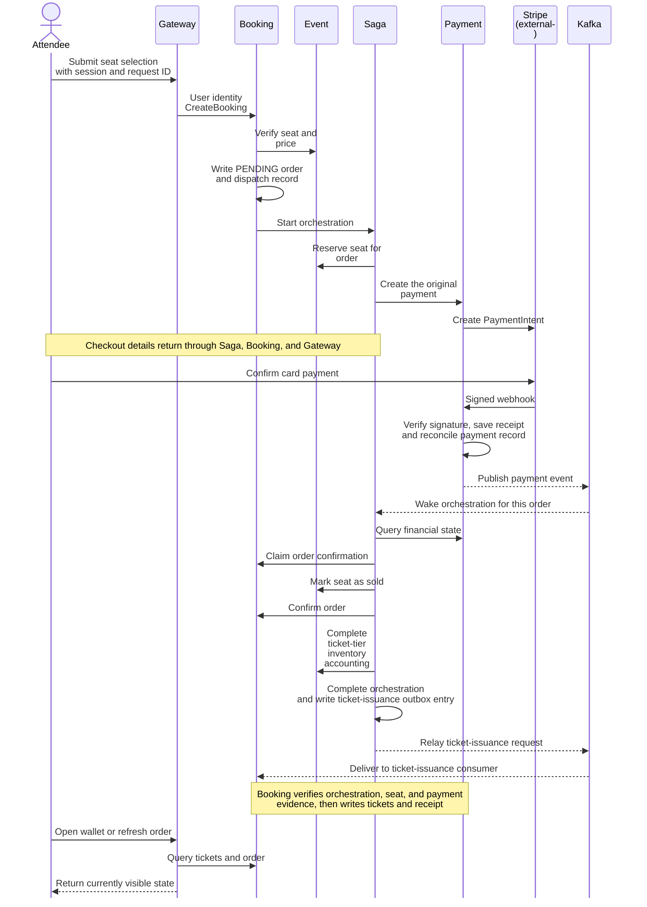
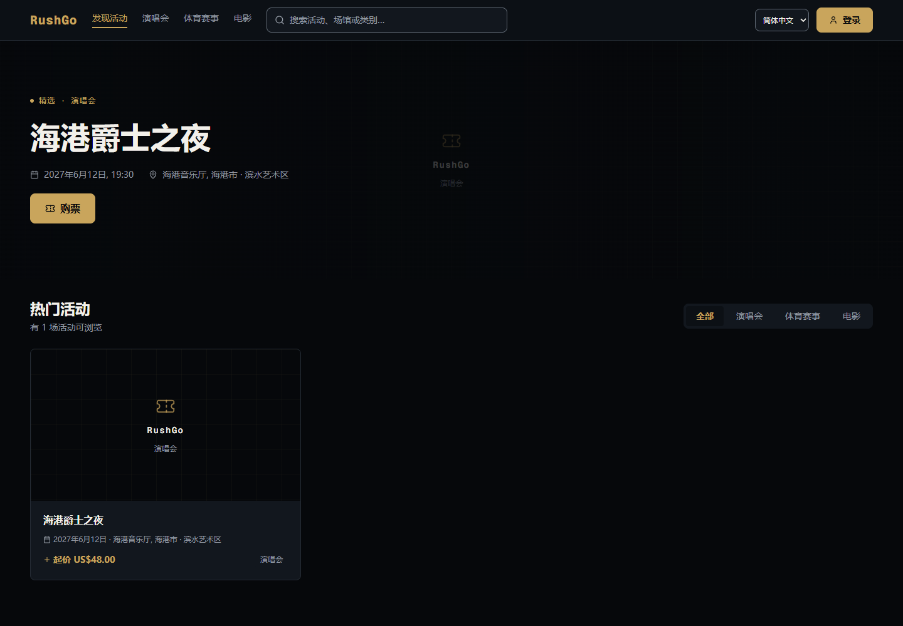
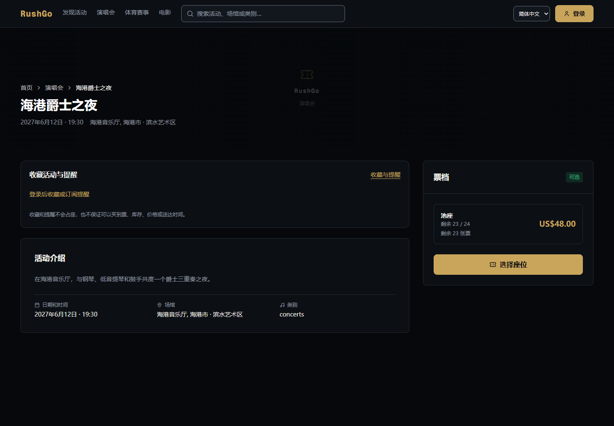
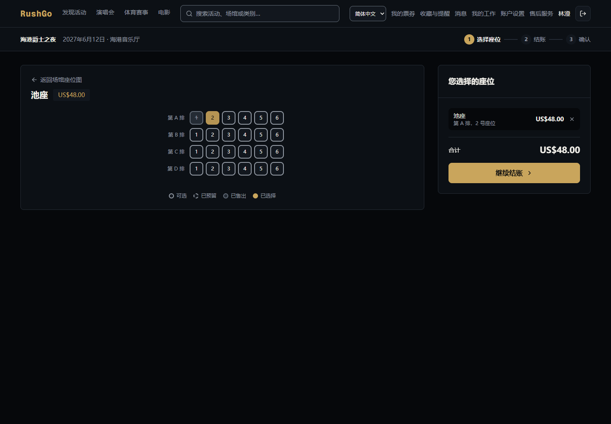
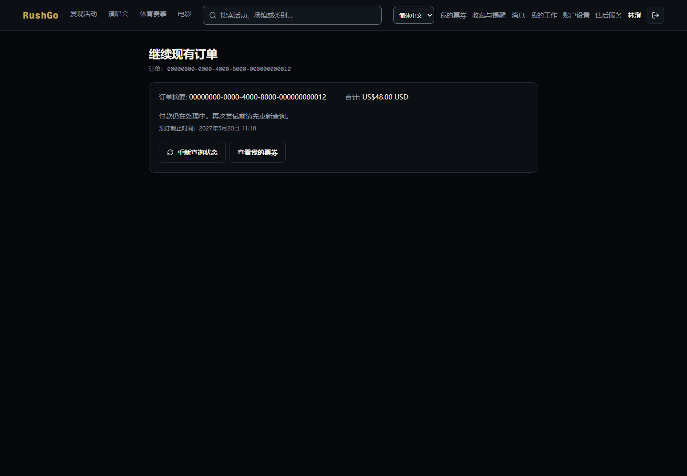
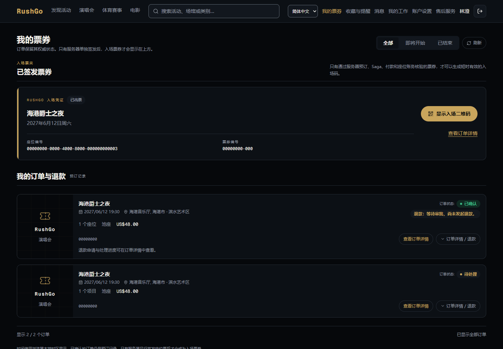
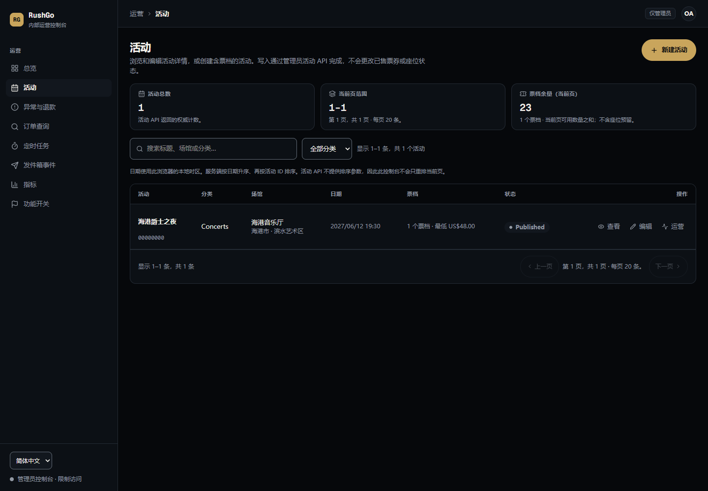
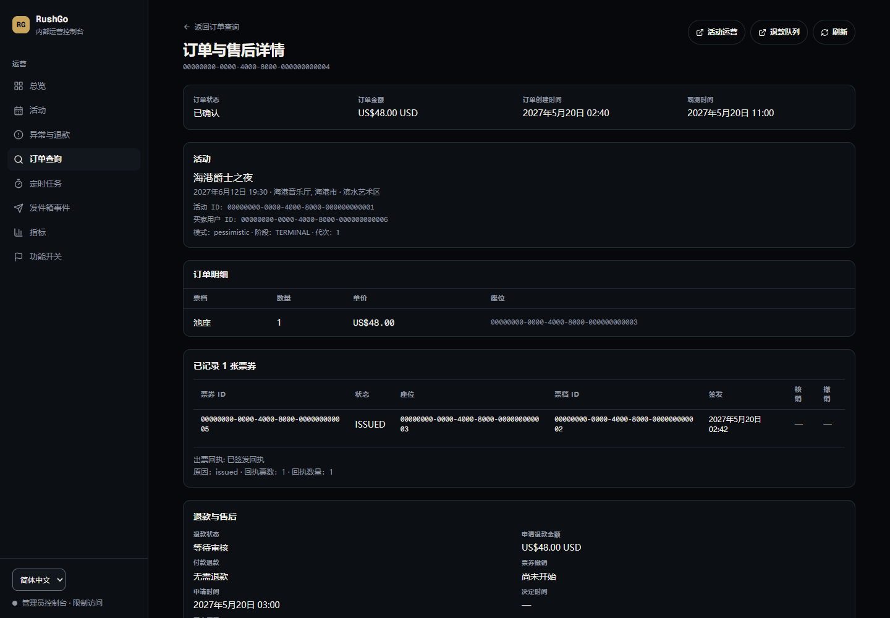
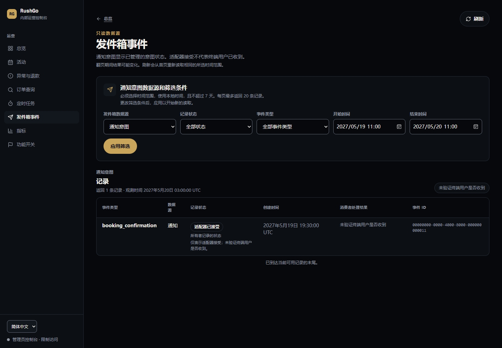

# RushGo

[简体中文](README.md) | [English](README.en.md)

RushGo is a microservices ticketing platform built with Go and Next.js. Attendees can discover events, select seats, and view orders and tickets. Event staff can validate tickets for events they are authorized to manage. Administrators can manage events and review sales and after-sales records. The order flow centers on a practical question: when two attendees select the same seat, or a payment result arrives after a reservation expires, which component may confirm the order, claim the seat, and issue the ticket?

RushGo is an independently maintained personal portfolio project. Start with the [page gallery](docs/SCREENSHOTS.en.md) to explore the interface, or run the read-only discovery demo below. To understand ticket purchasing, follow the order flow and its service entry points. [Demo guide](DEMO.en.md) · [Project status](PROJECT_STATUS.en.md)

## How to Run

| Goal | Mode | Requirements |
| --- | --- | --- |
| Open the home page and try search and category filters | A · [Read-only discovery page](DEMO.en.md#start-the-read-only-discovery-demo) | Two PowerShell windows, Node.js, and npm |
| Preview seat selection or administration, or regenerate the gallery | B · [Multi-page preview and screenshots](DEMO.en.md#multi-page-preview-and-screenshots) | A production frontend build, Playwright, and Chromium or Edge. Pages use local synthetic fixtures |
| Develop and debug the complete service stack | C · [Backend development environment](backend/README.en.md) | Docker Compose, seven databases, migrations, application roles, and private mTLS material. The frontend connects to the Gateway |

**For a first visit, Mode A is the recommended starting point.** Open two PowerShell windows at the repository root. This path was tested with Node.js 24.11.1 and npm 11.7.0. It does not require Go, Docker, or payment credentials.

In the first window, start the read-only API with three fictional events.

```powershell
node .\docs\demo\events-api.mjs
```

In the second window, start the website.

```powershell
cd frontend
npm ci
$env:NEXT_PUBLIC_API_URL = "http://127.0.0.1:8765"
npm run dev -- --hostname 127.0.0.1 --port 3000
```

Open <http://127.0.0.1:3000/> and search for `Harbor` to find **Harbor Jazz Weekend**. To stop the demo, press `Ctrl+C` in both windows. In the second window, clear the environment variable with `Remove-Item Env:NEXT_PUBLIC_API_URL -ErrorAction SilentlyContinue`. [HTTP checks and troubleshooting](DEMO.en.md#try-the-discovery-page) · [Frontend development guide](frontend/README.en.md)

## Feature Modules

| Module | Current capabilities |
| --- | --- |
| Accounts and roles | Registration codes, sign-in, session refresh, and password recovery. The Gateway separates public queries, authenticated operations, and administrative endpoints. |
| Event discovery and administration | Search events by keyword or category and view their details. The admin interface provides entry points to create and edit events and inspect event operations. |
| Ticket tiers, seats, and inventory | Maintain ticket prices and available quantities, record seat ownership, reservation expiry, and revisions, and publish updates to the seat-selection page. |
| Reservations and orders | Validate the event and ticket tier associated with a seat, preserve the unit price and total from the order request, and support order retrieval, cancellation, and resumption. |
| Payments and compensation | Create Stripe PaymentIntents and receive signed webhooks. The Saga advances confirmation or compensation based on payment and order state. |
| Tickets, wallet, and check-in | Validate ticket issuance eligibility against the order and seat. Ticket holders can view tickets and refresh entry credentials. Authorized staff can validate tickets. |
| After-sales | Ticket holders can request or withdraw a refund for an unused ticket. Event approvers can review and process requests. |
| Notifications | Consume order, user, and event events, record notifications, manage delivery and retries, and let users query their inbox. |
| Administrative queries | Let authorized users inspect order details, event tickets, and pending events to locate where an order flow stopped. |

## Technology Stack

| Component | Use in the project |
| --- | --- |
| Next.js 16.4.6, React 19.2.3, TypeScript | The App Router organizes attendee and admin pages. Next.js forwards matching `/api` requests to the configured API service. |
| Go 1.25.5, Gin, gRPC / Protocol Buffers | The Gateway exposes HTTP endpoints. Backend services call one another through typed RPC, with shared contracts maintained in the Go workspace. |
| PostgreSQL 16 | Compose provisions a separate database for each of the seven services with persistent business state. Orders, seats, payments, and orchestration progress each have an owning service. |
| Redis 7, SSE | Redis supports optional seat admission and realtime update distribution. The Gateway sends seat updates to the browser through Server-Sent Events. |
| Kafka | Carries payment-result notifications, ticket-issuance messages, and business events consumed by Notification. |
| Stripe | The frontend provides the payment form. Payment handles provider integration, webhook signature verification, and financial-state reconciliation. The integration is configured for TEST mode. |
| Docker Compose, Make | Describe the local backend topology and provide development commands for module builds and database migrations. |

Version references are available in the [frontend manifest](frontend/package.json), [Go workspace](backend/go.work), and [backend Compose configuration](backend/docker-compose.yml).

## Architecture and Service Responsibilities

The diagram shows the protocols, resource ownership, and main event flows between the current local Compose configuration and Go service entry points. A node whose label ends in `database` represents the independent PostgreSQL database read and written by that service. Service collaboration includes synchronous gRPC calls and event-driven asynchronous messages carried by Kafka. Dashed arrows represent asynchronous messages.



**Purpose.** Show the entry protocols, cross-service boundaries, and ownership of data and messages at a glance.

- The Gateway serves the browser through an HTTP API and seat SSE stream. It calls User, Event, Booking, Payment, Scheduler, and Notification over gRPC. Payment also exposes the Stripe webhook HTTP endpoint. [Gateway routes](backend/services/gateway/internal/router/router.go) · [Gateway entry point](backend/services/gateway/cmd/main.go) · [Payment entry point](backend/services/payment/cmd/main.go)
- Compose configures a separate PostgreSQL database for User, Event, Booking, Payment, Saga, Scheduler, and Notification. These services do not share a transaction database. [Local services and database configuration](backend/docker-compose.yml)
- The diagram shows payment wake-ups, ticket-issuance requests, and order notifications. Kafka also carries business messages from Booking, User, and Event to Notification, as well as Scheduler configuration-change events. [Topic definitions](backend/pkg/topics/topics.go) · [Notification consumer](backend/services/notification/internal/kafka/consumer.go) · [Scheduler consumer](backend/services/scheduler/internal/kafka/consumer.go)
- Gateway, Event, Booking, Notification, and Scheduler use Redis for authentication and subscriptions, seat admission and updates, ticket revocation checks, notification-management revocation checks, and reservation-cleanup coordination, respectively. [Gateway initialization](backend/services/gateway/cmd/main.go) · [Event initialization](backend/services/event/cmd/main.go) · [Booking initialization](backend/services/booking/cmd/main.go) · [Notification initialization](backend/services/notification/cmd/main.go) · [Scheduler initialization](backend/services/scheduler/cmd/main.go)

**Scope.** This is a local topology diagram based on the repository's current Compose file and service entry points. It does not describe network exposure in any deployment environment.

| Service entry point | Responsibility |
| --- | --- |
| [Gateway](backend/services/gateway/cmd/main.go) | Registers HTTP routes, performs authorization, forwards business requests to the relevant services, and provides the seat event stream. |
| [User](backend/services/user/cmd/main.go) | Manages users, authentication credentials, sessions, and roles. |
| [Event](backend/services/event/cmd/main.go) | Stores events, ticket tiers, and seats. Handles reservations, confirmation, and inventory accounting. |
| [Booking](backend/services/booking/cmd/main.go) | Owns orders and their lifecycle, dispatches orchestration requests, and handles ticket issuance, check-in, and after-sales. |
| [Payment](backend/services/payment/cmd/main.go) | Manages payment records, receives provider receipts, and handles cancellation, refunds, and reconciliation. |
| [Saga](backend/services/saga/cmd/main.go) | Persists order-orchestration progress and coordinates forward steps and compensation across Booking, Event, and Payment. |
| [Notification](backend/services/notification/cmd/main.go) | Consumes business events and maintains the inbox and delivery tasks. |
| [Scheduler](backend/services/scheduler/cmd/main.go) | Loads scheduled-task configuration, scans expiring reservations, and coordinates cleanup. |

## From Order to Ticket Issuance

The sequence below shows the managed-order happy path: synchronous requests, payment-receipt wake-up, and asynchronous ticket issuance. A Kafka payment message only prompts Saga to re-read Payment. It does not prove that funds were collected.



**Purpose.** Show how an order crosses asynchronous boundaries from a Stripe receipt to ticket records in Booking.

- Booking first reads event, seat, and ticket-tier facts from Event. It then stores the `PENDING` order, line items, and pending dispatch record in its own transaction. The dispatcher can retry Saga startup. [Order validation and recovery](backend/services/booking/internal/service/booking_service.go) · [Dispatch record](backend/services/booking/internal/repository/postgres_request_dispatch.go) · [Dispatch worker](backend/services/booking/internal/service/dispatch_worker.go)
- Saga persists five forward steps: reserve the seat, create the PaymentIntent, sell the seat, confirm Booking, and update ticket-tier sales accounting. After S1 completes, it pauses until payment wakes it. [Step definitions and execution](backend/services/saga/internal/service/service.go) · [Step effects](backend/services/saga/internal/service/replay_effects.go)
- Payment first verifies the Stripe webhook and saves the provider receipt. A receipt worker then records the financial observation and publishes a Kafka message. After a success or failure label arrives, Saga still re-reads Payment's financial state over gRPC. [Webhook](backend/services/payment/internal/http/http_handler.go) · [Receipt worker](backend/services/payment/internal/service/financial_worker.go) · [Saga consumer and reconciliation](backend/services/saga/internal/kafka/consumer.go) · [Saga wake-up handling](backend/services/saga/internal/service/service.go)
- When the final step completes, Saga writes the completion state and ticket-issuance outbox entry in one Saga database transaction. After the relay publishes it, the Booking consumer checks Saga, Event, and Payment eligibility, then commits tickets and the receipt together in the Booking database. [Saga result and outbox](backend/services/saga/internal/repository/postgres_saga_recovery.go) · [Relay](backend/services/saga/internal/service/ticket_issuance_outbox_relay.go) · [Booking consumer](backend/services/booking/internal/kafka/ticket_issuance_consumer.go) · [Ticket-issuance transaction](backend/services/booking/internal/repository/postgres_ticket_issuance.go)

**Scope.** This is the normal managed-payment and ticket-issuance path. See [Architecture notes](docs/ARCHITECTURE.en.md#closure-and-compensation) for terminal closure and compensation.

## Key Engineering Decisions

- **Seat contention.** When two orders see the same available seat, Event may first use Redis for admission. An infrastructure error at admission still falls through to the database path. PostgreSQL allows only an available seat to become reserved. Changing it to sold also requires a matching order, reservation generation, and valid expiry. [Admission call](backend/services/event/internal/service/event_service.go) · [Conditional seat update](backend/services/event/internal/repository/postgres_seat_lifecycle_repository.go)
- **Order retries.** For a create-order request with an idempotency key, Booking looks up an existing order by user and request key, then compares normalized request fingerprints. Replaying the same request can return the order. Reusing its key with different seats returns a conflict. [Order persistence](backend/services/booking/internal/repository/postgres_request_dispatch.go)
- **Orchestration recovery and compensation.** Saga records the current step, direction, and result. A worker persists the execution intent before calling a service and saves the result only while its claim remains valid. If a payment result is unclear, it must reconcile against Payment records. A Kafka message alone cannot confirm collection. [Step executor](backend/services/saga/internal/service/replay_executor.go) · [Payment event handling](backend/services/saga/internal/service/service.go)
- **Transactional Outbox.** Booking commits order confirmation and the pending event in one transaction. A relay reads batches with `FOR UPDATE SKIP LOCKED`, publishes them to Kafka, and then marks them as published. If publishing succeeds but the database commit fails, a message may be published again, so consumers must tolerate redelivery. [Order repository](backend/services/booking/internal/repository/postgres_booking_repository.go) · [Relay](backend/services/booking/internal/service/outbox_relay.go)
- **Seat-stream recovery.** After the SSE subscription is ready, the browser fetches a seat snapshot and merges buffered updates by seat revision. After reconnecting, it fetches a fresh snapshot and removes selections that are no longer available. The backend checks the seat again when the order is submitted. [Frontend synchronization](frontend/lib/api/seat-realtime.mjs) · [Gateway event stream](backend/services/gateway/internal/realtime/sse.go)

## Pages and User Journeys

| Role | Page entry points | What visitors can see |
| --- | --- | --- |
| Guest | `/`, `/events/[id]`, `/login`, `/register` | Search events and view schedules, venues, ticket tiers, and sign-in or registration entry points. |
| Buyer | `/events/[id]/seats`, `/checkout`, `/my-tickets`, `/aftersales` | View seats, order state, owned tickets, and refund entry points. |
| Event staff | `/work`, `/events/[id]/check-in` | Review assigned event duties and open the check-in tool from the workbench. |
| Administrator | `/admin/events`, `/admin/orders`, `/admin/outbox`, `/admin/metrics` | Inspect event inventory, selected orders, message-delivery records, and metrics. |

The eight screenshots below are captures of the actual frontend. Accounts, seats, orders, tickets, and operations for Harbor Jazz Night are local synthetic fixtures. Click a preview to open the original image. [Full page gallery and mobile screenshots](docs/SCREENSHOTS.en.md) · [Reproduce locally](DEMO.en.md#multi-page-preview-and-screenshots)

<table>
<tr><td><a href="docs/demo/screenshots/customer/customer-discover.png"></a><br>Event discovery</td><td><a href="docs/demo/screenshots/customer/customer-event-detail.png"></a><br>Event details · venue and ticket tiers</td></tr>
<tr><td><a href="docs/demo/screenshots/customer/customer-seat-selection.png"></a><br>Seat selection · select A2</td><td><a href="docs/demo/screenshots/customer/customer-checkout-status.png"></a><br>Checkout · view a pending order</td></tr>
<tr><td><a href="docs/demo/screenshots/customer/customer-ticket-wallet.png"></a><br>Ticket wallet · tickets and orders</td><td><a href="docs/demo/screenshots/admin/admin-events.png"></a><br>Administrator · event administration</td></tr>
<tr><td><a href="docs/demo/screenshots/admin/admin-order-detail.png"></a><br>Administrator · order and after-sales details</td><td><a href="docs/demo/screenshots/admin/admin-outbox.png"></a><br>Administrator · outbox events</td></tr>
</table>

## Repository Map and Documentation

| Location | Contents |
| --- | --- |
| [frontend/app](frontend/app) · [frontend/lib](frontend/lib) | Page routes, API client, and UI state handling |
| [backend/services](backend/services) · [backend/pkg](backend/pkg) | Eight service entry points and implementations, shared protocols, and infrastructure components |
| [Architecture notes](docs/ARCHITECTURE.en.md) · [Page gallery](docs/SCREENSHOTS.en.md) | Compensation, message idempotency, and seat-realtime recovery. Pages and sample screenshots are organized by role. |
| [Demo guide](DEMO.en.md) · [Project status](PROJECT_STATUS.en.md) | Demo steps, expected results, and verification boundaries |
| [Backend development guide](backend/README.en.md) · [Frontend development guide](frontend/README.en.md) | Backend databases, messaging, certificates, and configuration. Frontend development checks. |

Documentation is available in Simplified Chinese and English. When editing a page, update both versions and run `node docs/check-docs.mjs` to check their links. [Documentation checker](docs/check-docs.mjs)

## Project Status and Licensing

The local discovery page supports search and category filters. The multi-page gallery uses synthetic data to show buyer, staff, and admin interfaces. The complete online flow for sign-in, ordering, payments, ticket issuance, and after-sales remains unverified. Production operation is outside the scope of this demo.

The migration-script directory retains MIT notices for the original and modified works. The Geist font is distributed under the SIL Open Font License 1.1. The repository does not declare one license covering the entire application. Redistribution terms for the application as a whole still need confirmation. [Script license](backend/scripts/LICENSE) · [Font license](frontend/app/fonts/OFL.txt) · [Font sources](frontend/app/fonts/README.en.md)
