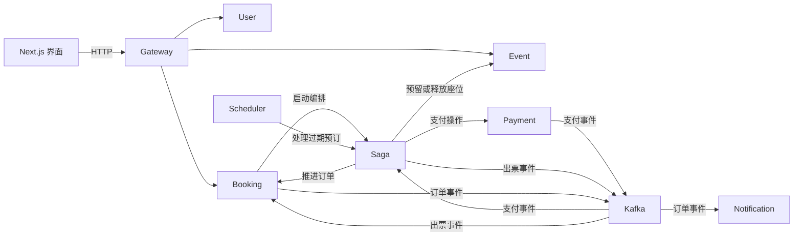
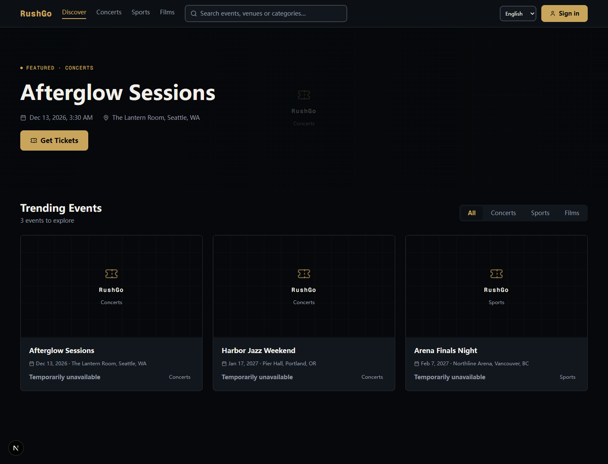

# RushGo

RushGo 是一个基于 Go 和 Next.js 的微服务票务系统。观众可以查询活动、选择座位并查看订单和票据，现场工作人员按活动授权核销票据，管理员维护活动并查询售票和售后记录。系统围绕一个具体问题组织订单流程：当两位观众同时选中一个座位，或支付结果晚于预订期限到达时，谁有权确认订单、占用座位和签发票据？

RushGo 是我独立维护的个人作品集项目。想先看界面，可以运行下方的本地演示，搜索和筛选三个虚构活动。想了解购票实现，可以从订单流程和对应服务入口读起。[演示指南](DEMO.md) · [项目状态](PROJECT_STATUS.md)

## 功能模块

| 模块 | 当前实现 |
| --- | --- |
| 账户与角色 | 注册验证码、登录、刷新会话和密码找回。Gateway 区分公开查询、已登录操作和管理接口。 |
| 活动发现与管理 | 按关键词或分类查询活动，查看详情。管理端提供创建、编辑活动和查看活动运营信息的入口。 |
| 票档、座位与库存 | 维护票档价格和可用数量，记录座位的预留归属、期限和版本，向选座页推送状态变化。 |
| 预订与订单 | 校验座位所属活动和票档，保存下单时的单价和总额，支持读取、取消和恢复订单。 |
| 支付与补偿 | 创建 Stripe PaymentIntent，接收签名 Webhook。Saga 根据支付和订单状态推进确认或补偿。 |
| 票据、钱包与核销 | 按订单和座位核对出票资格；持票人可以查看票据、更新入场凭证，获授权人员可以核销。 |
| 售后 | 持票人可申请或撤回未使用票的退款，活动审批人员可查看并处理申请。 |
| 通知 | 消费订单、用户和活动事件，记录通知并处理投递和重试，用户可查询通知收件箱。 |
| 管理查询 | 按权限查看订单详情、活动票据和待发布事件，便于追查一笔订单在哪一步停下。 |

## 技术栈

| 组件 | 项目中的用途 |
| --- | --- |
| Next.js 16.4.6、React 19.2.3、TypeScript | App Router 组织观众与管理页面，Next.js 将匹配的 `/api` 请求转发给配置的 API 服务。 |
| Go 1.25.5、Gin、gRPC / Protocol Buffers | Gateway 提供 HTTP 接口，后端通过类型化 RPC 调用各服务，共享契约随 Go 工作区维护。 |
| PostgreSQL 16 | Compose 为七个有持久化业务状态的服务分别配置数据库。订单、座位、支付和编排进度各有归属。 |
| Redis 7、SSE | Redis 用于可选的座位准入和实时更新分发。Gateway 将座位更新通过 SSE 发送给浏览器。 |
| Kafka | 传递支付结果通知、出票消息和通知服务订阅的业务事件。 |
| Stripe | 前端提供支付表单，Payment 服务负责支付适配、回调验签和资金状态核对。集成配置使用 TEST 模式。 |
| Docker Compose、Make | 描述本地后端拓扑，提供按模块构建、数据库迁移等开发命令。 |

版本依据见[前端清单](frontend/package.json)、[Go 工作区](backend/go.work)和[后端 Compose 配置](backend/docker-compose.yml)。

## 架构与服务职责

图中保留购票、出票、通知和过期处理的主要连接。服务名之间的实线表示调用，标有事件名的箭头表示消息的发布或消费。



| 服务入口 | 职责 |
| --- | --- |
| [Gateway](backend/services/gateway/cmd/main.go) | 注册 HTTP 路由，执行鉴权，将业务请求转给对应服务，向选座页提供事件流。 |
| [User](backend/services/user/cmd/main.go) | 管理用户、认证凭据、会话和角色。 |
| [Event](backend/services/event/cmd/main.go) | 保存活动、票档和座位，执行预留、确认及库存记账。 |
| [Booking](backend/services/booking/cmd/main.go) | 拥有订单及其生命周期，派发编排请求，处理出票、核销和售后。 |
| [Payment](backend/services/payment/cmd/main.go) | 管理支付记录，接收服务商回执，处理取消、退款及结果核对。 |
| [Saga](backend/services/saga/cmd/main.go) | 持久化订单编排进度，协调 Booking、Event 和 Payment 的正向步骤及补偿。 |
| [Notification](backend/services/notification/cmd/main.go) | 消费业务事件，维护收件箱和投递任务。 |
| [Scheduler](backend/services/scheduler/cmd/main.go) | 加载定时任务配置，扫描到期预订并协调清理。 |

## 一笔订单如何走到出票

1. **查询与选座。** 浏览器通过 Gateway 从 Event 获取活动、票档和座位快照。用户在界面选中的座位仍可能被其他订单抢先预留。
2. **建立订单。** Booking 重新校验活动、票档、座位及库存记账条件，把单价、明细、预订截止时间和派发状态写入数据库，订单从 `PENDING` 开始。[订单建立](backend/services/booking/internal/service/booking_service.go)
3. **预留与等待支付。** Booking 触发 Saga，Saga 先请求 Event 预留座位，再请求 Payment 创建 PaymentIntent，然后等待支付结果。启用 Redis 准入时，它在 Event 写库前筛掉冲突请求。[编排步骤](backend/services/saga/internal/service/service.go)
4. **处理支付结果。** Payment 验证 Stripe 签名并记录回执。支付事件唤醒 Saga 核对支付和订单的当前状态。满足确认条件后，Saga 依次请求锁定为已售座位、确认订单并更新票档余量。订单过期或失败时，编排按已执行的步骤释放资源并协调支付补偿。[回调入口](backend/services/payment/internal/http/http_handler.go) · [步骤与补偿](backend/services/saga/internal/service/replay_effects.go)
5. **签发票据。** Booking 消费出票事件，核对本地订单，并向 Saga、Event、Payment 查询编排、座位和支付依据。资格核对通过后才写入票据，收件凭据用于识别重复事件。[出票服务](backend/services/booking/internal/service/ticket_issuance.go)

## 关键工程设计

- **座位竞争。** 两笔订单看到同一张空座时，Event 可先用 Redis 进行准入。准入遇到基础设施错误时仍进入数据库路径。PostgreSQL 只允许可用座位转为预留，转为已售时还需匹配订单、预订代次和有效期限。[准入调用](backend/services/event/internal/service/event_service.go) · [座位条件更新](backend/services/event/internal/repository/postgres_seat_lifecycle_repository.go)
- **下单重试。** 对带请求标识的下单操作，Booking 用用户和请求标识查找已有订单，并比较规范化请求的摘要。同一请求可以取回订单，复用标识却更换座位会产生冲突。[下单持久化](backend/services/booking/internal/repository/postgres_request_dispatch.go)
- **编排中断与补偿。** Saga 记录当前步骤、执行方向和步骤结果。工作进程先持久化执行意图，再调用服务，最后在认领有效时保存结果。支付结果不明确时需要核对 Payment 记录，不能单凭一条 Kafka 消息确认收款。[步骤执行器](backend/services/saga/internal/service/replay_executor.go) · [支付事件处理](backend/services/saga/internal/service/service.go)
- **事务 Outbox。** Booking 在同一事务内提交订单确认和待发布事件。后台转发器用 `FOR UPDATE SKIP LOCKED` 分批读取，发送到 Kafka 后标记已发布。若发送成功后数据库提交失败，消息可能重发，消费方仍需处理重复投递。[订单仓储](backend/services/booking/internal/repository/postgres_booking_repository.go) · [转发器](backend/services/booking/internal/service/outbox_relay.go)
- **选座页断线恢复。** 浏览器在 SSE 订阅就绪后取座位快照，将这段时间缓冲的增量按座位版本合并。重连后重新拉取快照，移除已经不可用的选择；用户提交时仍由后端检查座位。[前端同步逻辑](frontend/lib/api/seat-realtime.mjs) · [Gateway 事件流](backend/services/gateway/internal/realtime/sse.go)

## 本地演示 · 活动发现页

准备 Node.js 和 npm（本地复核使用 Node.js 24）。这个入口只运行 Next.js 和只读样例 API，无需账户、支付密钥或后端容器。

在仓库根目录打开两个 PowerShell 窗口。在第一个窗口启动样例 API。

```powershell
node .\docs\demo\events-api.mjs
```

在第二个窗口安装锁定版本的前端依赖，将 API 指向样例服务，然后启动 Next.js。

```powershell
cd frontend
npm ci
$env:NEXT_PUBLIC_API_URL = "http://127.0.0.1:8765"
npm run dev -- --hostname 127.0.0.1 --port 3000
```

打开 <http://127.0.0.1:3000/>。搜索 `Harbor` 可看到一场爵士乐活动，清空搜索后选择 `Sports` 可看到一场体育活动。下图为本地发现页，三个活动均为虚构样例，库存为零。



## 目录与文档

| 位置 | 内容 |
| --- | --- |
| [frontend/app](frontend/app) · [frontend/lib](frontend/lib) | 页面路由、API 客户端和界面状态处理 |
| [backend/services](backend/services) · [backend/pkg](backend/pkg) | 八个服务的入口与实现、共享协议和基础组件 |
| [docs/demo](docs/demo) | 只读样例 API 和页面截图 |
| [演示指南](DEMO.md) · [项目状态](PROJECT_STATUS.md) | 演示步骤、预期结果及各层验证范围 |
| [后端开发说明](backend/README.md) · [前端开发说明](frontend/README.md) | 完整后端所需数据库、消息服务、证书和配置，以及前端开发检查 |

## 当前状态与许可

公开演示覆盖活动发现、搜索和分类。登录、下单、支付、出票及售后的完整联机流程仍待验收；生产运行不在本项目的演示承诺范围内。

迁移脚本目录保留了原作与修改作品的 MIT 声明，Geist 字体使用 SIL Open Font License 1.1。仓库未声明覆盖整个应用的统一许可证，整体再分发许可仍需确认。[脚本许可](backend/scripts/LICENSE) · [字体许可](frontend/app/fonts/OFL.txt) · [字体来源](frontend/app/fonts/README.md)
