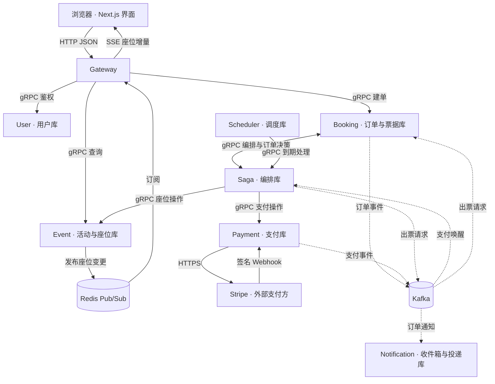
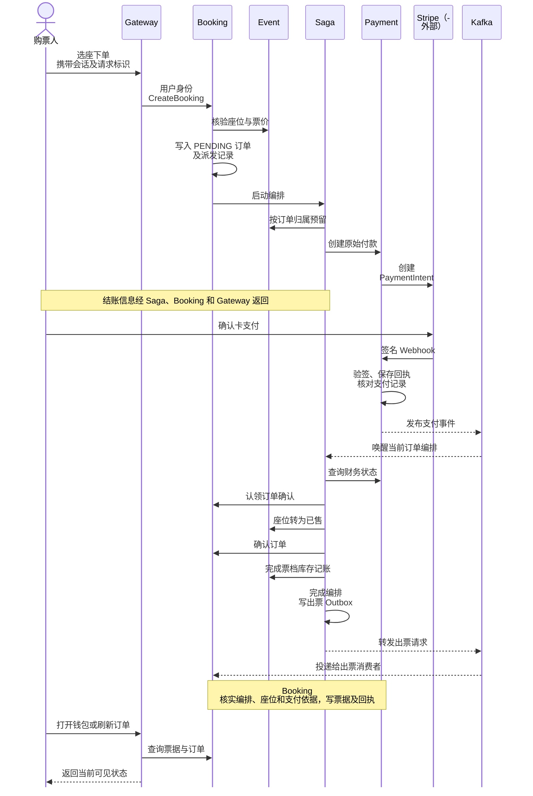
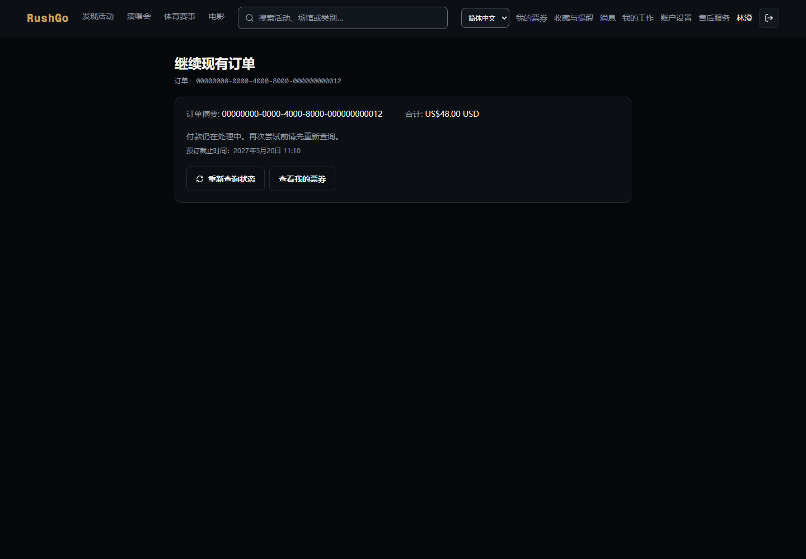

# RushGo

[简体中文](README.md) | [English](README.en.md)

RushGo 是一个基于 Go 和 Next.js 的微服务票务系统。观众可以查询活动、选择座位并查看订单和票据，现场工作人员按活动授权核销票据，管理员维护活动并查询售票和售后记录。系统围绕一个具体问题组织订单流程：当两位观众同时选中一个座位，或支付结果晚于预订期限到达时，谁有权确认订单、占用座位和签发票据？

RushGo 是我独立维护的个人作品集项目。想先看界面，可以浏览[页面图册](docs/SCREENSHOTS.md)，也可以运行下方的只读发现页演示。想了解购票实现，可以从订单流程和对应服务入口读起。[演示指南](DEMO.md) · [项目状态](PROJECT_STATUS.md)

## 如何启动

| 想做什么 | 选哪种模式 | 需要什么 |
| --- | --- | --- |
| 打开首页，试搜索和分类 | A · [只读发现页](DEMO.md#启动只读发现页) | 两个 PowerShell 窗口、Node.js 和 npm |
| 查看选座或管理页，或重新生成图册 | B · [多页面预览与截图](DEMO.md#多页面预览与截图) | 前端生产构建、Playwright 和 Chromium 或 Edge；页面读取本地合成样例 |
| 开发和调试完整服务 | C · [后端开发环境](backend/README.md) | Docker Compose、七个数据库、迁移、应用角色和私有 mTLS 材料；前端连接 Gateway |

**第一次打开项目，推荐模式 A。** 在仓库根目录打开两个 PowerShell 窗口。实测使用 Node.js 24.11.1、npm 11.7.0。此模式无需 Go、Docker 或支付密钥。

窗口一启动三个虚构活动的只读 API。

```powershell
node .\docs\demo\events-api.mjs
```

窗口二启动网页。

```powershell
cd frontend
npm ci
$env:NEXT_PUBLIC_API_URL = "http://127.0.0.1:8765"
npm run dev -- --hostname 127.0.0.1 --port 3000
```

打开 <http://127.0.0.1:3000/>，搜索 `Harbor` 可看到 **Harbor Jazz Weekend**。结束时在两个窗口分别按 `Ctrl+C`，然后在窗口二执行 `Remove-Item Env:NEXT_PUBLIC_API_URL -ErrorAction SilentlyContinue`。[HTTP 检查与常见问题](DEMO.md#在发现页试一遍) · [前端开发说明](frontend/README.md)

## 功能模块

| 模块 | 当前实现 |
| --- | --- |
| 账户与角色 | 注册验证码、登录、刷新会话和密码找回。Gateway 区分公开查询、已登录操作和管理接口。 |
| 活动发现与管理 | 按关键词或分类查询活动，查看详情。管理端提供创建、编辑活动和查看活动运营信息的入口。 |
| 票档、座位与库存 | 维护票档价格和可用数量，记录座位的预留归属、期限和版本，向选座页推送状态变化。 |
| 预订与订单 | 校验座位所属活动和票档，保存下单时的单价和总额，支持读取、取消和恢复订单。 |
| 支付与补偿 | 创建 Stripe PaymentIntent，接收签名 Webhook。Saga 根据支付和订单状态推进确认或补偿。 |
| 票据、钱包与核销 | 按订单和座位核对出票资格；持票人可以查看票据、更新入场凭证，获授权人员可以核销。 |
| 售后 | 持票人可申请或撤回未使用票的退款，活动审批人员可查看并处理申请。 |
| 通知 | 消费订单、用户和活动事件，记录通知并处理投递和重试，用户可查询通知收件箱。 |
| 管理查询 | 按权限查看订单详情、活动票据和待发布事件，便于追查一笔订单在哪一步停下。 |

## 技术栈

| 组件 | 项目中的用途 |
| --- | --- |
| Next.js 16.4.6、React 19.2.3、TypeScript | App Router 组织观众与管理页面，Next.js 将匹配的 `/api` 请求转发给配置的 API 服务。 |
| Go 1.25.5、Gin、gRPC / Protocol Buffers | Gateway 提供 HTTP 接口，后端通过类型化 RPC 调用各服务，共享契约随 Go 工作区维护。 |
| PostgreSQL 16 | Compose 为七个有持久化业务状态的服务分别配置数据库。订单、座位、支付和编排进度各有归属。 |
| Redis 7、SSE | Redis 用于可选的座位准入和实时更新分发。Gateway 将座位更新通过 SSE 发送给浏览器。 |
| Kafka | 传递支付结果通知、出票消息和通知服务订阅的业务事件。 |
| Stripe | 前端提供支付表单，Payment 服务负责支付适配、回调验签和资金状态核对。集成配置使用 TEST 模式。 |
| Docker Compose、Make | 描述本地后端拓扑，提供按模块构建、数据库迁移等开发命令。 |

版本依据见[前端清单](frontend/package.json)、[Go 工作区](backend/go.work)和[后端 Compose 配置](backend/docker-compose.yml)。

## 架构与服务职责

下图说明当前本地 Compose 配置与 Go 入口之间的协议、资源归属和主要事件流。节点中以“库”结尾的名称表示该服务读写的独立 PostgreSQL 数据库。服务协作包含同步 gRPC 调用与由 Kafka 承载的事件驱动异步消息。虚线表示异步消息。



**用途。** 让读者一次看清入口协议、跨服务边界以及数据和消息由谁持有。

- Gateway 为浏览器提供 HTTP API 和座位 SSE；它通过 gRPC 调用 User、Event、Booking、Payment、Scheduler、Notification。Payment 另开 Stripe webhook HTTP 入口。[Gateway 路由](backend/services/gateway/internal/router/router.go) · [Gateway 入口](backend/services/gateway/cmd/main.go) · [Payment 入口](backend/services/payment/cmd/main.go)
- Compose 为 User、Event、Booking、Payment、Saga、Scheduler、Notification 配置各自的 PostgreSQL 数据库；服务间不共享一个事务库。[本地服务与数据库配置](backend/docker-compose.yml)
- 图中展示了支付唤醒、出票请求和订单通知。Kafka 还承载 Booking、User、Event 发往 Notification 的业务消息，以及 Scheduler 配置变更事件。[主题定义](backend/pkg/topics/topics.go) · [Notification 消费者](backend/services/notification/internal/kafka/consumer.go) · [Scheduler 消费者](backend/services/scheduler/internal/kafka/consumer.go)
- Redis 被 Gateway、Event、Booking、Notification 和 Scheduler 使用，分别支撑认证/订阅、座位准入与推送、票据撤销检查、通知管理的撤销检查和预订清理协调。[Gateway 初始化](backend/services/gateway/cmd/main.go) · [Event 初始化](backend/services/event/cmd/main.go) · [Booking 初始化](backend/services/booking/cmd/main.go) · [Notification 初始化](backend/services/notification/cmd/main.go) · [Scheduler 初始化](backend/services/scheduler/cmd/main.go)

**范围。** 这是仓库当前 Compose 与服务入口的本地拓扑图，不代表任何部署环境的网络暴露方式。

| 服务入口 | 职责 |
| --- | --- |
| [Gateway](backend/services/gateway/cmd/main.go) | 注册 HTTP 路由，执行鉴权，将业务请求转给对应服务，向选座页提供事件流。 |
| [User](backend/services/user/cmd/main.go) | 管理用户、认证凭据、会话和角色。 |
| [Event](backend/services/event/cmd/main.go) | 保存活动、票档和座位，执行预留、确认及库存记账。 |
| [Booking](backend/services/booking/cmd/main.go) | 拥有订单及其生命周期，派发编排请求，处理出票、核销和售后。 |
| [Payment](backend/services/payment/cmd/main.go) | 管理支付记录，接收服务商回执，处理取消、退款及结果核对。 |
| [Saga](backend/services/saga/cmd/main.go) | 持久化订单编排进度，协调 Booking、Event 和 Payment 的正向步骤及补偿。 |
| [Notification](backend/services/notification/cmd/main.go) | 消费业务事件，维护收件箱和投递任务。 |
| [Scheduler](backend/services/scheduler/cmd/main.go) | 加载定时任务配置，扫描到期预订并协调清理。 |

## 一笔订单如何走到出票

下面按托管订单的正常成功路径展示同步请求、支付回执唤醒和异步出票。Kafka 支付消息只是让 Saga 重新查询 Payment，不直接证明收款。



**用途。** 展示订单建立后如何跨越异步边界，从 Stripe 回执走到 Booking 中的票据记录。

- Booking 先从 Event 读取活动、座位与票档事实，再在自己的事务中存入 `PENDING` 订单、明细和待派发信息；派发进程可重试 Saga 启动。[订单校验与恢复](backend/services/booking/internal/service/booking_service.go) · [派发记录](backend/services/booking/internal/repository/postgres_request_dispatch.go) · [派发 worker](backend/services/booking/internal/service/dispatch_worker.go)
- Saga 持久化五个正向步骤：预留座位、创建 PaymentIntent、售出座位、确认 Booking、更新票档销售记账；S1 完成后暂停等待支付唤醒。[步骤定义与执行](backend/services/saga/internal/service/service.go) · [步骤效果](backend/services/saga/internal/service/replay_effects.go)
- Payment 先验证 Stripe webhook 并保存 provider receipt，再由 receipt worker 记录财务观察并发 Kafka 消息；Saga 收到成功或失败标签后，仍通过 gRPC 重读 Payment 财务状态。[Webhook](backend/services/payment/internal/http/http_handler.go) · [receipt worker](backend/services/payment/internal/service/financial_worker.go) · [Saga 消费与核对](backend/services/saga/internal/kafka/consumer.go) · [Saga 唤醒处理](backend/services/saga/internal/service/service.go)
- Saga 最后一个步骤完成时，在 Saga 数据库同一事务中写完成状态和出票 outbox；后台 relay 发布后，Booking 消费者查 Saga、Event、Payment 资格，再把票据与回执一起提交到 Booking 数据库。[Saga 结果与 outbox](backend/services/saga/internal/repository/postgres_saga_recovery.go) · [relay](backend/services/saga/internal/service/ticket_issuance_outbox_relay.go) · [Booking 消费者](backend/services/booking/internal/kafka/ticket_issuance_consumer.go) · [出票事务](backend/services/booking/internal/repository/postgres_ticket_issuance.go)

**范围。** 这是托管订单的正常付款及出票路径；终态关闭与补偿见[架构专题](docs/ARCHITECTURE.md#关闭与补偿)。

## 关键工程设计

- **座位竞争。** 两笔订单看到同一张空座时，Event 可先用 Redis 进行准入。准入遇到基础设施错误时仍进入数据库路径。PostgreSQL 只允许可用座位转为预留，转为已售时还需匹配订单、预订代次和有效期限。[准入调用](backend/services/event/internal/service/event_service.go) · [座位条件更新](backend/services/event/internal/repository/postgres_seat_lifecycle_repository.go)
- **下单重试。** 对带请求标识的下单操作，Booking 用用户和请求标识查找已有订单，并比较规范化请求的摘要。同一请求可以取回订单，复用标识却更换座位会产生冲突。[下单持久化](backend/services/booking/internal/repository/postgres_request_dispatch.go)
- **编排中断与补偿。** Saga 记录当前步骤、执行方向和步骤结果。工作进程先持久化执行意图，再调用服务，最后在认领有效时保存结果。支付结果不明确时需要核对 Payment 记录，不能单凭一条 Kafka 消息确认收款。[步骤执行器](backend/services/saga/internal/service/replay_executor.go) · [支付事件处理](backend/services/saga/internal/service/service.go)
- **事务 Outbox。** Booking 在同一事务内提交订单确认和待发布事件。后台转发器用 `FOR UPDATE SKIP LOCKED` 分批读取，发送到 Kafka 后标记已发布。若发送成功后数据库提交失败，消息可能重发，消费方仍需处理重复投递。[订单仓储](backend/services/booking/internal/repository/postgres_booking_repository.go) · [转发器](backend/services/booking/internal/service/outbox_relay.go)
- **选座页断线恢复。** 浏览器在 SSE 订阅就绪后取座位快照，将这段时间缓冲的增量按座位版本合并。重连后重新拉取快照，移除已经不可用的选择；用户提交时仍由后端检查座位。[前端同步逻辑](frontend/lib/api/seat-realtime.mjs) · [Gateway 事件流](backend/services/gateway/internal/realtime/sse.go)

## 页面与操作入口

| 角色 | 页面入口 | 可以查看的内容 |
| --- | --- | --- |
| 访客 | `/`、`/events/[id]`、`/login`、`/register` | 搜索活动，查看时间、地点、票档与登录注册入口。 |
| 购票人 | `/events/[id]/seats`、`/checkout`、`/my-tickets`、`/aftersales` | 查看座位、订单状态、持有的票据和退款入口。 |
| 活动工作人员 | `/work`、`/events/[id]/check-in` | 按活动查看获分配的职责，从工作台打开检票工具。 |
| 管理员 | `/admin/events`、`/admin/orders`、`/admin/outbox`、`/admin/metrics` | 查看活动库存、指定订单、消息投递记录和指标。 |

以下八张图来自真实前端。海港爵士之夜的账号、座位、订单、票据及运营记录均为本地合成样例。点击图片可看原图。[完整页面图册与移动端截图](docs/SCREENSHOTS.md) · [本地复现](DEMO.md#多页面预览与截图)

<table>
<tr><td><a href="docs/demo/screenshots/customer/customer-discover.png"></a><br>活动发现</td><td><a href="docs/demo/screenshots/customer/customer-event-detail.png"></a><br>活动详情 · 场馆与票档</td></tr>
<tr><td><a href="docs/demo/screenshots/customer/customer-seat-selection.png"></a><br>选座 · 点选 A2</td><td><a href="docs/demo/screenshots/customer/customer-checkout-status.png"></a><br>结账 · 查看待处理订单</td></tr>
<tr><td><a href="docs/demo/screenshots/customer/customer-ticket-wallet.png"></a><br>我的票券 · 持票与订单</td><td><a href="docs/demo/screenshots/admin/admin-events.png"></a><br>管理员 · 活动管理</td></tr>
<tr><td><a href="docs/demo/screenshots/admin/admin-order-detail.png"></a><br>管理员 · 订单与售后详情</td><td><a href="docs/demo/screenshots/admin/admin-outbox.png"></a><br>管理员 · 发件箱事件</td></tr>
</table>

## 目录与文档

| 位置 | 内容 |
| --- | --- |
| [frontend/app](frontend/app) · [frontend/lib](frontend/lib) | 页面路由、API 客户端和界面状态处理 |
| [backend/services](backend/services) · [backend/pkg](backend/pkg) | 八个服务的入口与实现、共享协议和基础组件 |
| [架构专题](docs/ARCHITECTURE.md) · [页面图册](docs/SCREENSHOTS.md) | 补偿、消息幂等与实时座位恢复；按角色查页面和样例截图 |
| [演示指南](DEMO.md) · [项目状态](PROJECT_STATUS.md) | 演示步骤、预期结果及各层验证范围 |
| [后端开发说明](backend/README.md) · [前端开发说明](frontend/README.md) | 完整后端所需数据库、消息服务、证书和配置，以及前端开发检查 |

本项目提供简体中文和英文文档。修改文档时，请同步更新两个版本，并运行 `node docs/check-docs.mjs` 检查链接。[文档校验脚本](docs/check-docs.mjs)

## 当前状态与许可

本地发现页支持搜索和分类。多页面图册以合成数据展示购票、工作人员和管理界面。登录、下单、支付、出票及售后的完整联机流程仍待验收；生产运行不在本项目的演示承诺范围内。

迁移脚本目录保留了原作与修改作品的 MIT 声明，Geist 字体使用 SIL Open Font License 1.1。仓库未声明覆盖整个应用的统一许可证，整体再分发许可仍需确认。[脚本许可](backend/scripts/LICENSE) · [字体许可](frontend/app/fonts/OFL.txt) · [字体来源](frontend/app/fonts/README.md)
