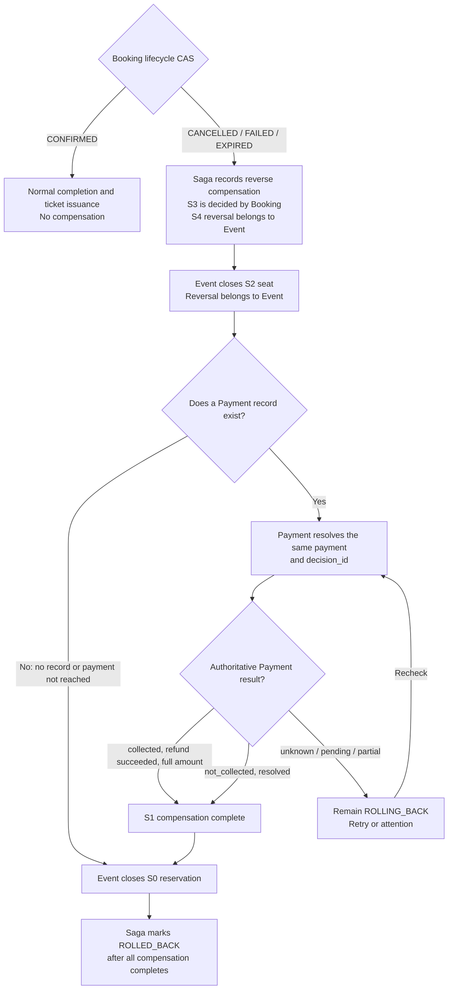
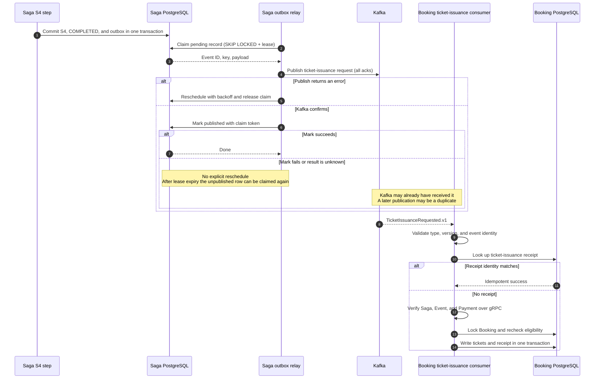
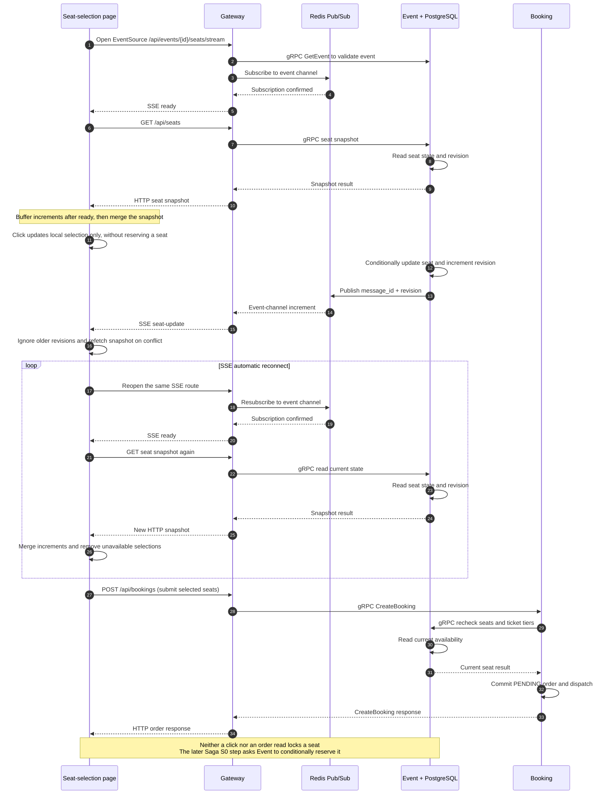

# RushGo Architecture Notes

[简体中文](ARCHITECTURE.md) | [English](ARCHITECTURE.en.md)

The [service-topology diagram in the README](../README.en.md#architecture-and-service-responsibilities) shows the current local services, protocols, and ownership of data resources. The [order-to-ticket-issuance sequence](../README.en.md#from-order-to-ticket-issuance) shows payment wake-up and asynchronous ticket issuance. This page covers three separate recovery and realtime-data paths. These flows combine synchronous gRPC calls with event-driven asynchronous Kafka messages.

## Closure and Compensation

**Purpose.** Explain which component determines the terminal order outcome after cancellation, expiry, or failure, and why an uncertain payment result or incomplete refund cannot be treated as completed compensation.

- Booking uses a versioned lifecycle CAS (optimistic concurrency control) to determine the terminal state and enqueues a `settle` dispatch in its own database. Saga re-reads Booking and proceeds with compensation only when the winning terminal state is not a confirmed order. [Booking lifecycle update](../backend/services/booking/internal/repository/postgres_lifecycle_repository.go) · [Booking dispatch](../backend/services/booking/internal/service/dispatch_worker.go) · [Saga terminal-state check](../backend/services/saga/internal/service/replay_effects.go)
- Saga stores the orchestration direction, step results, and operation obligations in its own database. It records an execution intent before each external service call, then commits the result only when the claim token and fencing state remain valid. Compensation runs the steps in reverse order. [Saga executor](../backend/services/saga/internal/service/replay_executor.go) · [Saga compensation state](../backend/services/saga/internal/repository/postgres_saga_settlement.go)
- Event owns seat state and inventory accounting. For compensation steps S2 and S0, Saga requests Event `close` with a stable operation identity. Booking's terminal CAS handles S3. Event's seat-closure path reverses S4 sales accounting. [Compensation steps](../backend/services/saga/internal/service/replay_effects.go) · [Event seat lifecycle](../backend/services/event/internal/repository/postgres_seat_lifecycle_repository.go)
- Payment owns provider outcomes and cancellation and refund facts. Saga's `RequestPaymentResolution` includes Booking's `decision_id`. A collected-payment path completes only after a full refund has `succeeded`. An uncollected-payment path completes only when the provider reports `not_collected` and reconciliation is `resolved`. [Payment resolution service](../backend/services/payment/internal/service/payment_service.go) · [Payment gRPC](../backend/services/payment/internal/grpc/server.go)
- An `unknown` result, an in-progress or insufficient refund, or any failed authoritative query leaves Saga responsible for recovery. A Kafka wake-up does not replace Payment reconciliation and cannot turn an incomplete refund into a successful one. [Saga step execution and retries](../backend/services/saga/internal/service/replay_executor.go) · [Saga financial compensation checks](../backend/services/saga/internal/service/replay_effects.go)

**Scope.** The diagram shows terminal-state compensation for managed-order Saga generation 1. It does not cover legacy unmanaged orders or manual offline refunds.

## Transactional Outbox and Consumer Idempotency: Ticket Issuance

**Purpose.** Use Saga's ticket-issuance request to explain how PostgreSQL commit, Kafka publication, and Booking-side idempotency fit together, and why a message can still be delivered more than once.

- Saga writes the S4 result, `COMPLETED` state, and the `saga_ticket_issuance_outbox` row in one Saga database transaction. Saga ID determines the ticket-issuance ID, so the same Saga cannot create a different event identity. [Step-result transaction](../backend/services/saga/internal/repository/postgres_saga_recovery.go) · [Outbox payload](../backend/services/saga/internal/repository/ticket_issuance_outbox.go)
- The relay claims pending records with `FOR UPDATE SKIP LOCKED` and a lease. The ticket-issuance producer uses Kafka all-acks. On success, it marks the row as published only while the claim is valid. On failure, it retries with backoff. [Outbox repository](../backend/services/saga/internal/repository/ticket_issuance_outbox.go) · [Relay](../backend/services/saga/internal/service/ticket_issuance_outbox_relay.go) · [Producer](../backend/services/saga/internal/kafka/producer.go)
- The Booking consumer accepts only the versioned `TicketIssuanceRequested.v1` type and requires the outer Kafka event ID to match the ticket-issuance ID inside the payload. An invalid identity is a permanent error. [Topic and event types](../backend/pkg/topics/event_types.go) · [Booking consumer](../backend/services/booking/internal/kafka/ticket_issuance_consumer.go)
- Booking checks the full receipt identity. An exact match with an existing receipt is a successful replay. A conflicting identity fails. Without a receipt, it verifies Saga, Event, and Payment eligibility, then locks and rechecks the order and writes tickets and the receipt in one local Booking transaction. [Ticket-issuance service](../backend/services/booking/internal/service/ticket_issuance.go) · [Ticket-issuance repository transaction](../backend/services/booking/internal/repository/postgres_ticket_issuance.go)
- Kafka delivery and PostgreSQL's `published` marker do not share a distributed transaction, so exactly-once delivery is not promised. Booking's receipt and stable event identity absorb duplicates. An authoritative `unknown` query remains retryable. [Outbox relay](../backend/services/saga/internal/service/ticket_issuance_outbox_relay.go) · [Ticket-issuance handling](../backend/services/booking/internal/service/ticket_issuance.go)

**Scope.** This is the Saga-to-Booking ticket-issuance event contract. It documents a local transactional outbox with consumer idempotency, not a shared transaction between PostgreSQL and Kafka.

## Seat Realtime: Subscription Readiness, Snapshot Recovery, and Revision Merging

**Purpose.** Explain how SSE increments, Redis Pub/Sub, and Event snapshots work together to maintain the seat-selection state, especially during reconnects.

- Event increments `seat_revision` when PostgreSQL conditionally updates a seat. Redis admission screens contention early. PostgreSQL's conditional update decides whether the seat changes. [Seat lifecycle repository](../backend/services/event/internal/repository/postgres_seat_lifecycle_repository.go) · [Redis admission](../backend/services/event/internal/admission/redis_admission.go)
- After the database write succeeds, Event publishes Redis batches grouped by event. Each batch contains `message_id`, seat state, and a string-form revision. A Redis publish failure is logged and raises an alert, but does not roll back the PostgreSQL update. [Event update and publish](../backend/services/event/internal/service/event_service.go) · [Redis batch format](../backend/services/event/internal/service/seat_realtime.go)
- Gateway sends SSE `ready` only after Redis confirms the subscription. It then emits `seat-update` frames and heartbeats. On a disconnected stream or a slow client, the client can subscribe again. [Gateway SSE handler](../backend/services/gateway/internal/handler/event_handler.go) · [Hub](../backend/services/gateway/internal/realtime/hub.go) · [SSE frames](../backend/services/gateway/internal/realtime/sse.go)
- After each `ready`, the frontend fetches the authoritative snapshot and buffers increments that arrive while it loads. It accepts only higher seat revisions, drops duplicate message IDs, and requests a new snapshot on a conflicting state with the same revision or malformed input. A click changes local selection only. It does not reserve the seat. [Seat synchronizer](../frontend/lib/api/seat-realtime.mjs) · [Seat-page integration](../frontend/app/%28customer%29/events/%5Bid%5D/seats/page.tsx)
- When EventSource reconnects, it goes through `ready` again. The synchronizer fetches a new snapshot and removes unavailable selections. Before order creation, Booking re-reads availability. Saga S0 then asks Event to conditionally reserve the seat. [Reconnect and merge](../frontend/lib/api/seat-realtime.mjs) · [Booking validation](../backend/services/booking/internal/service/booking_service.go) · [Saga S0](../backend/services/saga/internal/service/replay_effects.go)

**Scope.** Redis Pub/Sub provides low-latency increments, not a durable event log. Snapshots and server-side validation when submitting the order provide authoritative state.
