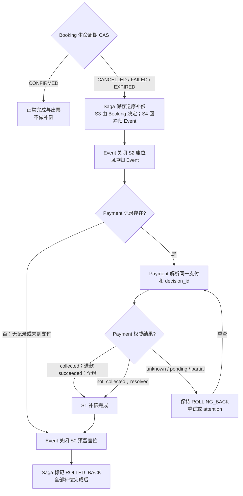
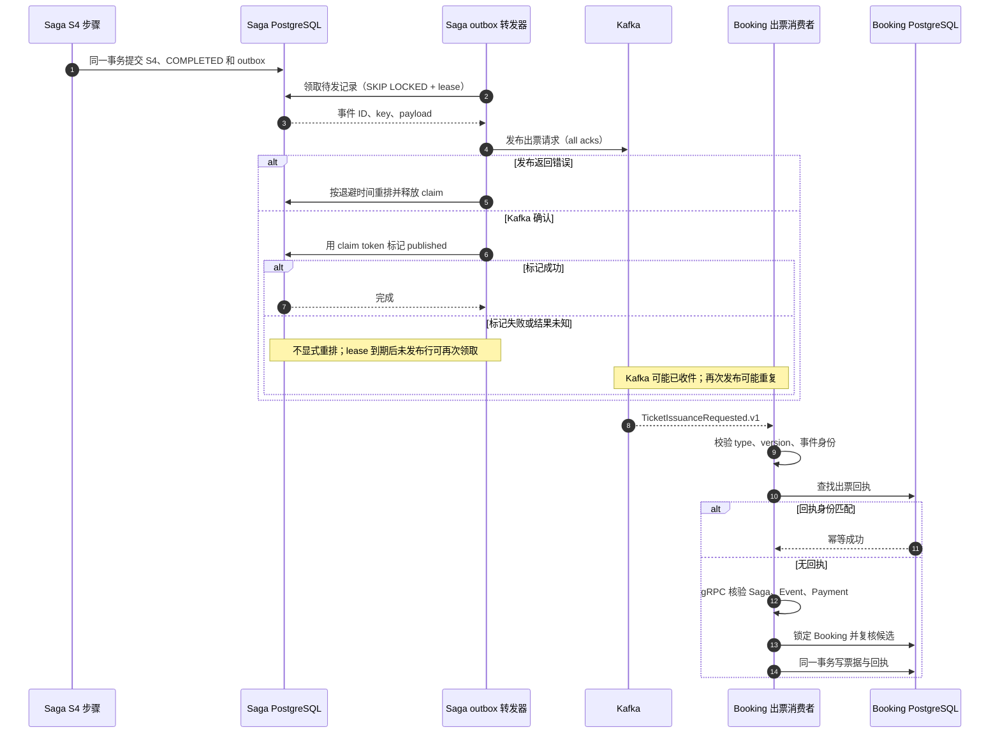
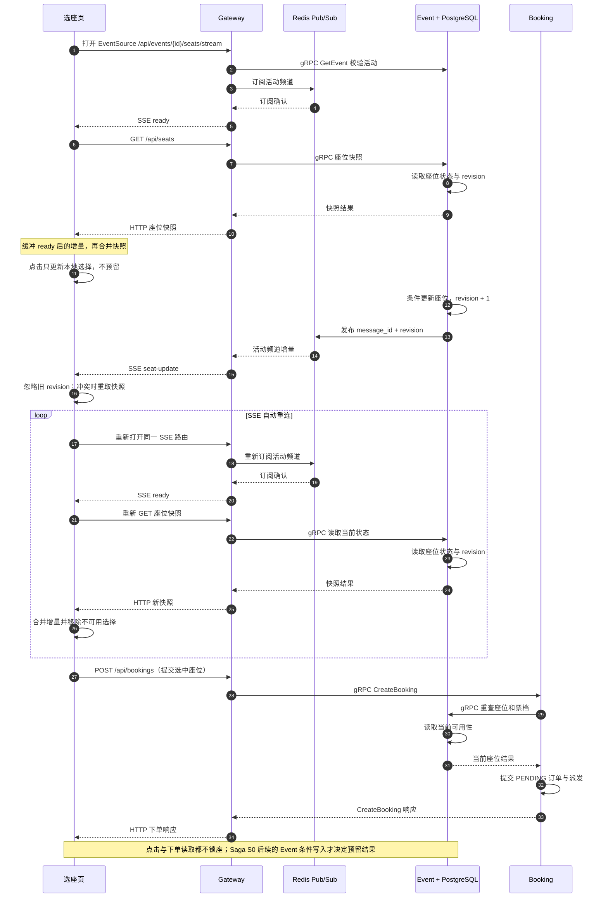

# RushGo 架构专题

[简体中文](ARCHITECTURE.md) | [English](ARCHITECTURE.en.md)

[README 的服务拓扑图](../README.md#架构与服务职责)展示当前本地服务、协议和数据资源归属；[正常订单到出票图](../README.md#一笔订单如何走到出票)展示支付唤醒及异步出票。本页补充三条各自独立的恢复和实时数据链路。这些流程结合了同步 gRPC 调用与 Kafka 事件驱动异步消息。

## 关闭与补偿

**用途。** 说明取消、过期或失败后由谁决定订单终态，以及支付结果不确定或退款未完成时为什么不能宣布补偿完成。

- Booking 用带版本的生命周期 CAS（乐观并发控制）决定终态，并在自己的数据库中排入 `settle` 派发；Saga 先重读 Booking，只有获胜的终态且订单未确认时才推进补偿。[Booking 生命周期更新](../backend/services/booking/internal/repository/postgres_lifecycle_repository.go) · [Booking 派发](../backend/services/booking/internal/service/dispatch_worker.go) · [Saga 终态核对](../backend/services/saga/internal/service/replay_effects.go)
- Saga 在自己的数据库中保存方向、步骤结果和操作义务；每次调用外部服务前写入执行意图，调用结果再以认领令牌与 fencing 状态提交。补偿按步骤逆序恢复。[Saga 执行器](../backend/services/saga/internal/service/replay_executor.go) · [Saga 补偿状态](../backend/services/saga/internal/repository/postgres_saga_settlement.go)
- Event 拥有座位状态和库存记账：补偿 S2/S0 时，Saga 用稳定操作身份请求 Event `close`；S3 由 Booking 的终态 CAS 负责，S4 的销售记账回冲归 Event 的座位关闭路径。[补偿步骤](../backend/services/saga/internal/service/replay_effects.go) · [Event 座位生命周期](../backend/services/event/internal/repository/postgres_seat_lifecycle_repository.go)
- Payment 拥有 provider outcome、取消和退款事实。Saga 的 `RequestPaymentResolution` 带上 Booking 的 `decision_id`；已收款路径只在全额退款状态为 `succeeded` 后完成，未收款路径只在 provider outcome 为 `not_collected` 且 reconciliation 为 `resolved` 后完成。[Payment 解析服务](../backend/services/payment/internal/service/payment_service.go) · [Payment gRPC](../backend/services/payment/internal/grpc/server.go)
- `unknown`、退款处理中、退款金额不足或任何权威查询失败都会保留 Saga 恢复责任；Kafka 唤醒不能替代 Payment 核对，也不会把未完成退款变成成功。[Saga 步骤执行与重试](../backend/services/saga/internal/service/replay_executor.go) · [Saga 财务补偿检查](../backend/services/saga/internal/service/replay_effects.go)

**范围。** 图示托管订单的 generation 1 Saga 终态补偿，不覆盖旧版 unmanaged 订单或人工线下退款流程。

## Outbox 与消费者幂等：出票请求的实际生产与消费

**用途。** 以 Saga 的出票请求为例，说明 PostgreSQL 提交、Kafka 发布和 Booking 侧幂等如何衔接，以及为什么消息仍可能重复。

- Saga S4 完成结果、`COMPLETED` 状态及 `saga_ticket_issuance_outbox` 行由同一个 Saga 数据库事务提交；出票 ID 由 Saga ID 确定，同一 Saga 不会生成不同事件身份。[步骤结果事务](../backend/services/saga/internal/repository/postgres_saga_recovery.go) · [Outbox payload](../backend/services/saga/internal/repository/ticket_issuance_outbox.go)
- Relay 用 `FOR UPDATE SKIP LOCKED` 认领待发记录并设置 lease；出票 producer 使用 Kafka all-acks，成功后才按有效 claim 标记 published，失败则按退避时间重试。[Outbox 仓储](../backend/services/saga/internal/repository/ticket_issuance_outbox.go) · [Relay](../backend/services/saga/internal/service/ticket_issuance_outbox_relay.go) · [Producer](../backend/services/saga/internal/kafka/producer.go)
- Booking consumer 只接受版本化的 `TicketIssuanceRequested.v1`，并要求 Kafka 外层事件 ID 与 payload 内的出票 ID 一致；无效身份是永久错误。[Topic 与类型](../backend/pkg/topics/event_types.go) · [Booking consumer](../backend/services/booking/internal/kafka/ticket_issuance_consumer.go)
- Booking 检查完整回执身份；完全相同的既有回执作为重放成功返回，冲突身份失败。没有回执时先核实 Saga、Event、Payment 资格，再在 Booking 本地事务里锁定并复核订单、写票据及回执。[出票服务](../backend/services/booking/internal/service/ticket_issuance.go) · [出票仓储事务](../backend/services/booking/internal/repository/postgres_ticket_issuance.go)
- Kafka 接收成功与 PostgreSQL `published` 标记不在同一分布式事务内，所以不承诺 exactly-once 投递；重复发布由 Booking 回执和稳定身份吸收，权威查询 `unknown` 则返回可重试错误。[Outbox Relay](../backend/services/saga/internal/service/ticket_issuance_outbox_relay.go) · [出票处理](../backend/services/booking/internal/service/ticket_issuance.go)

**范围。** 这是 Saga 到 Booking 的出票事件契约；它说明本地事务 outbox 加消费者幂等，不代表 PostgreSQL 与 Kafka 之间存在共同事务。

## 座位实时流：订阅就绪、快照恢复与 revision 合并

**用途。** 说明 SSE 增量、Redis Pub/Sub 和 Event 快照怎样共同维持选座页状态，特别是断线重连期间如何恢复。

- Event 在 PostgreSQL 条件更新座位时递增 `seat_revision`；Redis 准入只负责提前筛选竞争，PostgreSQL 条件更新仍决定座位变更结果。[座位生命周期仓储](../backend/services/event/internal/repository/postgres_seat_lifecycle_repository.go) · [Redis admission](../backend/services/event/internal/admission/redis_admission.go)
- Event 在数据库写入成功后发布按活动聚合的 Redis 批次；每批包含 `message_id`、座位状态与字符串形式的 revision。Redis 发布失败会记录并告警，但不会把 PostgreSQL 变更回滚。[Event 更新与发布](../backend/services/event/internal/service/event_service.go) · [Redis 批次格式](../backend/services/event/internal/service/seat_realtime.go)
- Gateway 只有在 Redis 订阅确认后才发送 SSE `ready`，随后输出 `seat-update` 和心跳；SSE 断开或客户端慢速时，客户端可重新订阅。[Gateway SSE handler](../backend/services/gateway/internal/handler/event_handler.go) · [Hub](../backend/services/gateway/internal/realtime/hub.go) · [SSE frames](../backend/services/gateway/internal/realtime/sse.go)
- 前端在每次 `ready` 后拉取权威快照，并把快照加载期间的增量暂存；只接受更高的 seat revision，丢弃重复 message ID，遇到相同 revision 的状态冲突或格式错误时要求重取快照。点击只改变本地选择，不会预留座位。[座位同步器](../frontend/lib/api/seat-realtime.mjs) · [选座页接线](../frontend/app/%28customer%29/events/%5Bid%5D/seats/page.tsx)
- 断线后 EventSource 重连会重新经过 `ready`，同步器随即重拉快照并移除已不可用的选择；最终下单由 Booking 重新读取可用性，实际预留由 Saga S0 调用 Event 条件写入决定。[重连与合并](../frontend/lib/api/seat-realtime.mjs) · [Booking 校验](../backend/services/booking/internal/service/booking_service.go) · [Saga S0](../backend/services/saga/internal/service/replay_effects.go)

**范围。** Redis Pub/Sub 提供低延迟增量而非持久事件日志；快照与下单时的服务端校验负责权威性。
