# RushGo Page Gallery

[简体中文](SCREENSHOTS.md) | [English](SCREENSHOTS.en.md)

From event discovery and booking to ticket entry, refund review, and operations, this gallery covers every page in the Next.js route tree. Use the index to jump to a page description, or open a screenshot to view it at full size.

The screenshots were rendered from the current page components in a local Chromium browser. Dynamic pages use one consistent synthetic sample for Harbor Jazz Night. Buyers, event staff, and administrators have separate preview identities. “Static form” means the form was displayed without being submitted; protected forms use the corresponding synthetic preview identity. All amounts, orders, tickets, and operations records shown are sample data. No payment, email, check-in, or approval was performed.

Desktop viewport: 1440 × 1000. Mobile viewport: 390 × 844. Device scale factor: 1. The application UI in these screenshots is Simplified Chinese, with a dark theme and the Asia/Shanghai time zone. The sample clock is fixed at May 20, 2027, 11:00.

[Reproduction and interactive preview](../DEMO.en.md) · [Per-image source index](demo/screenshot-index.json) · [Architecture and business flows](ARCHITECTURE.en.md)

## Page Index

| Page | Route | Preview role | Screenshot | Data source | Coverage |
| --- | --- | --- | --- | --- | --- |
| [Event discovery](#page-customer-discover) | `/` | Visitor | [Desktop](demo/screenshots/customer/customer-discover.png) | Local synthetic data | Captured |
| [Event details](#page-customer-event-detail) | `/events/[id]` | Visitor | [Desktop](demo/screenshots/customer/customer-event-detail.png) | Local synthetic data | Captured |
| [Seat selection](#page-customer-seat-selection) | `/events/[id]/seats` | Buyer | [Desktop](demo/screenshots/customer/customer-seat-selection.png) | Local synthetic data | Captured |
| [Resume an existing order](#page-customer-checkout-status) | `/checkout` | Buyer | [Desktop](demo/screenshots/customer/customer-checkout-status.png) | Local synthetic data | Captured |
| [Log in](#page-customer-login) | `/login` | Visitor | [Desktop](demo/screenshots/customer/customer-login.png) | Static form | Captured |
| [Create an account](#page-customer-register) | `/register` | Visitor | [Desktop](demo/screenshots/customer/customer-register.png) | Static form | Captured |
| [Forgot password](#page-customer-forgot-password) | `/forgot-password` | Visitor | [Desktop](demo/screenshots/customer/customer-forgot-password.png) | Static form | Captured |
| [Reset password](#page-customer-reset-password) | `/reset-password` | Visitor | [Desktop](demo/screenshots/customer/customer-reset-password.png) | Static form | Captured |
| [Account settings](#page-customer-account) | `/account` | Buyer | [Desktop](demo/screenshots/customer/customer-account.png) | Local synthetic data | Captured |
| [After-sales](#page-customer-aftersales) | `/aftersales` | Buyer | [Desktop](demo/screenshots/customer/customer-aftersales.png) | Static form | Captured |
| [Favorites and alerts](#page-customer-favorites) | `/favorites` | Buyer | [Desktop](demo/screenshots/customer/customer-favorites.png) | Local synthetic data | Captured |
| [My tickets](#page-customer-ticket-wallet) | `/my-tickets` | Buyer | [Desktop](demo/screenshots/customer/customer-ticket-wallet.png) | Local synthetic data | Captured |
| [Order details](#page-customer-order-detail) | `/my-tickets/orders/[id]` | Buyer | [Desktop](demo/screenshots/customer/customer-order-detail.png) | Local synthetic data | Captured |
| [Notifications](#page-customer-notifications) | `/notifications` | Buyer | [Desktop](demo/screenshots/customer/customer-notifications.png) | Local synthetic data | Captured |
| [My assignments](#page-customer-staff-work) | `/work` | Event staff | [Desktop](demo/screenshots/customer/customer-staff-work.png) | Local synthetic data | Captured |
| [Ticket check-in](#page-customer-staff-check-in) | `/events/[id]/check-in` | Event staff | [Desktop](demo/screenshots/customer/customer-staff-check-in.png) | Static form | Captured |
| [Overview](#page-admin-overview) | `/admin` | Administrator | [Desktop](demo/screenshots/admin/admin-overview.png) | Local synthetic data | Captured |
| [Events](#page-admin-events) | `/admin/events` | Administrator | [Desktop](demo/screenshots/admin/admin-events.png) | Local synthetic data | Captured |
| [Event refund review](#page-admin-event-refunds) | `/admin/events/[id]/refunds` | Administrator | [Desktop](demo/screenshots/admin/admin-event-refunds.png) | Local synthetic data | Captured |
| [Event operations](#page-admin-event-operations) | `/admin/events/[id]/operations` | Administrator | [Desktop](demo/screenshots/admin/admin-event-operations.png) | Local synthetic data | Captured |
| [Find an order](#page-admin-order-lookup) | `/admin/orders` | Administrator | [Desktop](demo/screenshots/admin/admin-order-lookup.png) | Local synthetic data | Captured |
| [Order and after-sales details](#page-admin-order-detail) | `/admin/orders/[id]` | Administrator | [Desktop](demo/screenshots/admin/admin-order-detail.png) | Local synthetic data | Captured |
| [Exceptions and refunds](#page-admin-exceptions-refunds) | `/admin/operations` | Administrator | [Desktop](demo/screenshots/admin/admin-exceptions-refunds.png) | Local synthetic data | Captured |
| [Outbox events](#page-admin-outbox) | `/admin/outbox` | Administrator | [Desktop](demo/screenshots/admin/admin-outbox.png) | Local synthetic data | Captured |
| [Scheduled jobs](#page-admin-scheduler-jobs) | `/admin/ops` | Administrator | [Desktop](demo/screenshots/admin/admin-scheduler-jobs.png) | Local synthetic data | Captured |
| [Feature flags](#page-admin-feature-flags) | `/admin/flags` | Administrator | [Desktop](demo/screenshots/admin/admin-feature-flags.png) | Local synthetic data | Captured |
| [Operations metrics](#page-admin-metrics) | `/admin/metrics` | Administrator | [Desktop](demo/screenshots/admin/admin-metrics.png) | Local synthetic data | Captured |

## Attendees and Buyers

### Event Discovery

`/` · Visitor · [Page source](../frontend/app/%28customer%29/page.tsx)

Browse public events, ticket-tier prices, and venue information.

- Harbor Jazz Night event card
- Public event search and category filters
- Event date, venue, and price summary

**Screenshot** — Local synthetic data. A read-only event sample in the current Simplified Chinese UI. No account, booking, or payment is involved.

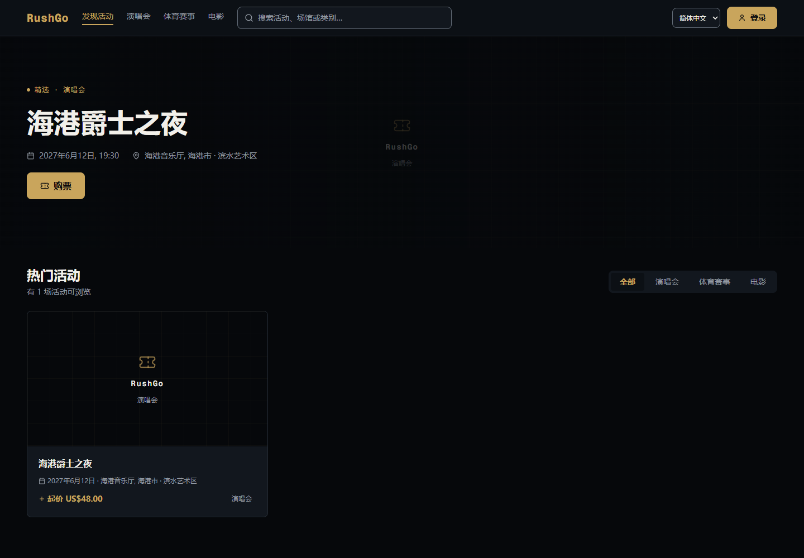

### Event Details

`/events/[id]` · Visitor · [Page source](../frontend/app/%28customer%29/events/%5Bid%5D/page.tsx)

Review the event description, time, venue, ticket tiers, and link to seat selection.

- Event description and venue information
- Stalls price and available quantity
- Link to the seating chart

**Screenshot** — Local synthetic data. Public event details are read-only. The server still has to confirm live inventory after a seat is selected.

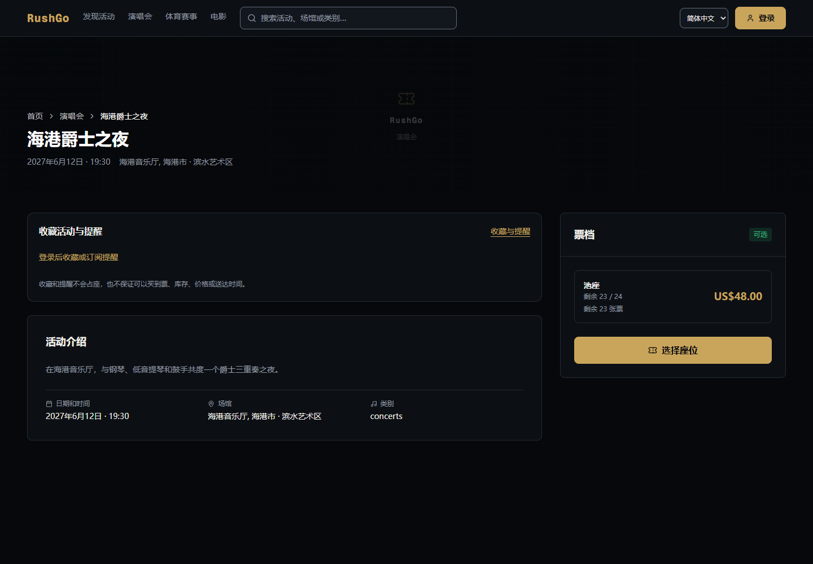

### Seat Selection

`/events/[id]/seats` · Buyer · [Page source](../frontend/app/%28customer%29/events/%5Bid%5D/seats/page.tsx)

Review the seat state from a snapshot and live updates, then select an available seat.

- 24 stalls seats
- A1 sold, A2 available
- Selected seat and amount summary
- Live inventory connection status

**Screenshot** — Local synthetic data. Shows a local sample selection of A2. Checkout was not continued, and no order or seat hold was created.

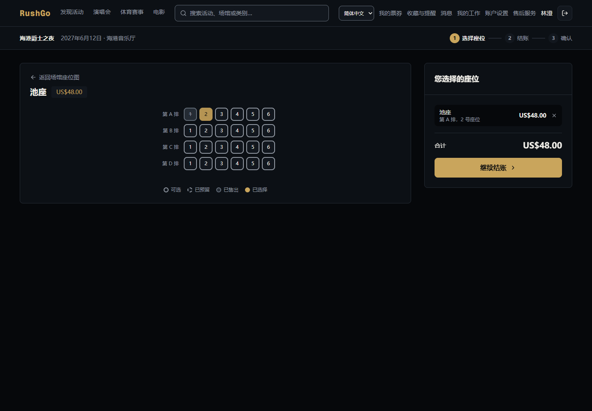

### Resume an Existing Order

`/checkout` · Buyer · [Page source](../frontend/app/%28customer%29/checkout/page.tsx)

View an existing order's payment-processing state and safe follow-up options.

- Order ID and total
- Payment processing status
- Links to view the order or check again

**Screenshot** — Local synthetic data. Replays only the processing snapshot from the order before A2 was held. The local browser intercepts the resume request, which is not forwarded to a server. No Stripe form or payment credentials are provided.

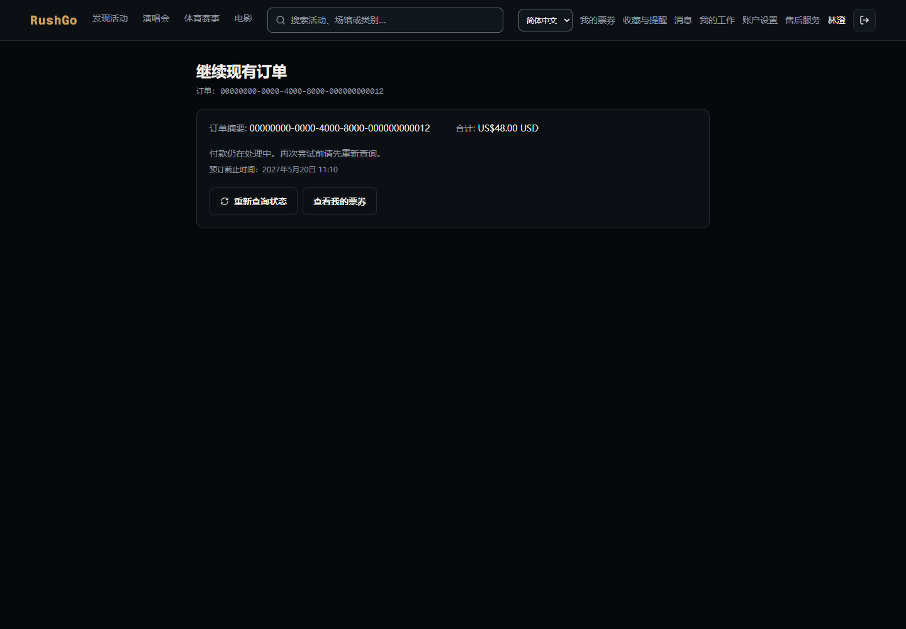

### Log In

`/login` · Visitor · [Page source](../frontend/app/%28customer%29/login/page.tsx)

View the login form and a safe return path.

- Email and password inputs
- Forgot-password link
- Registration link

**Screenshot** — Static form. The blank form is displayed without submitting credentials or creating a session.

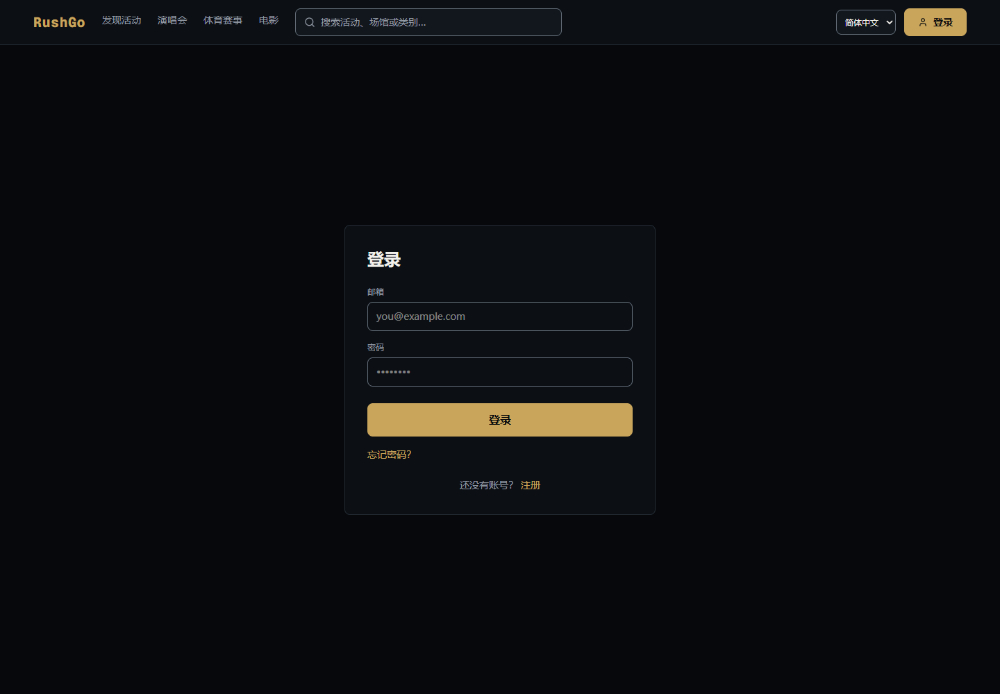

### Create an Account

`/register` · Visitor · [Page source](../frontend/app/%28customer%29/register/page.tsx)

View the entry points for registration, email verification, and password rules.

- Name and email fields
- Request-registration-code entry point
- Password confirmation field

**Screenshot** — Static form. The unsubmitted registration form is displayed. No verification code was requested and no account was created.

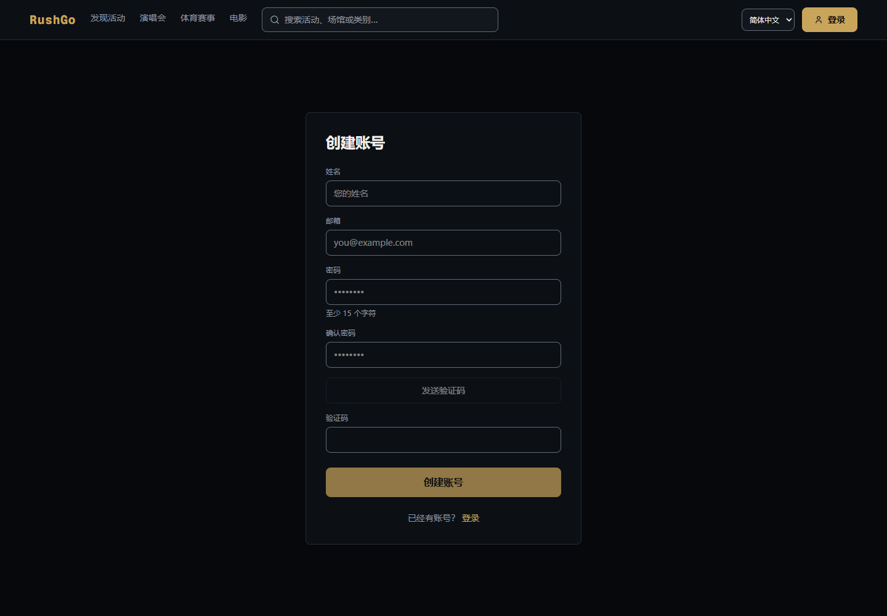

### Forgot Password

`/forgot-password` · Visitor · [Page source](../frontend/app/%28customer%29/forgot-password/page.tsx)

View the email form used to request password recovery.

- Email input
- Recovery request button
- Return-to-login link

**Screenshot** — Static form. The form is displayed without submission. No password-reset email was requested or sent.

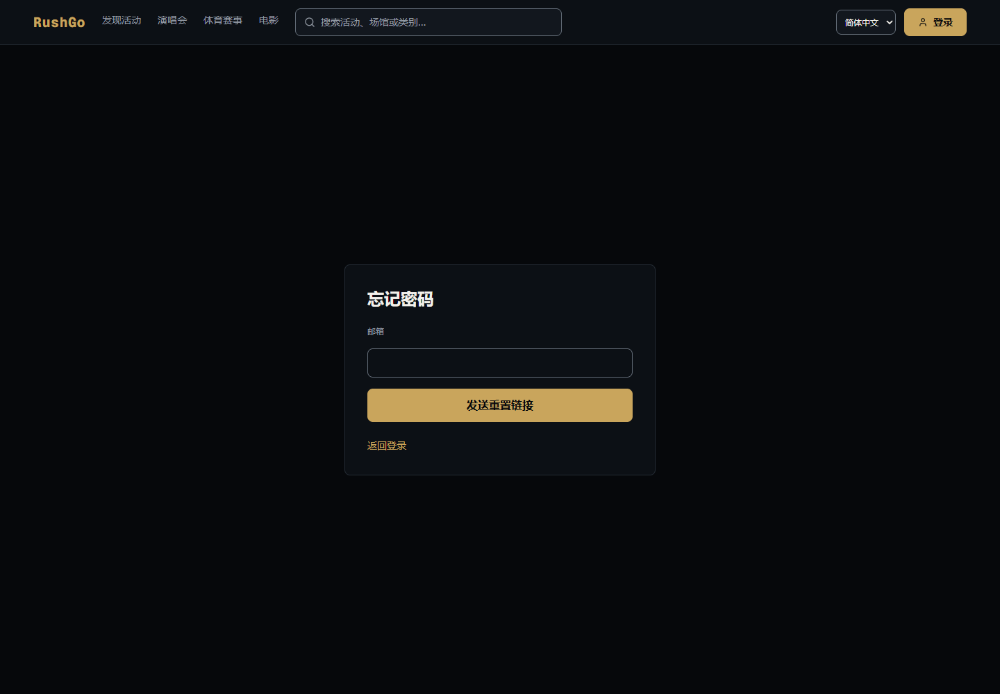

### Reset Password

`/reset-password` · Visitor · [Page source](../frontend/app/%28customer%29/reset-password/page.tsx)

Show the safe limits of the reset form and the option to obtain a fresh, valid email link.

- New-password and confirmation fields
- Password-length guidance
- Entry point to request a new reset link

**Screenshot** — Static form. No valid reset token is used. The form stays disabled, and no password change is submitted.

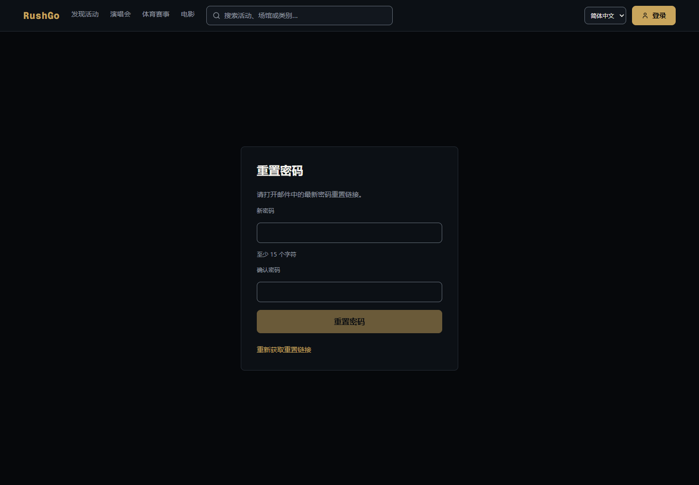

### Account Settings

`/account` · Buyer · [Page source](../frontend/app/%28customer%29/account/page.tsx)

View the current profile, language preference, and security settings.

- Lin Cheng's sample profile
- Simplified Chinese language preference
- Password and email update forms

**Screenshot** — Local synthetic data. The profile comes from a read-only user snapshot. Nothing is saved, no code is requested, and no credentials are changed.

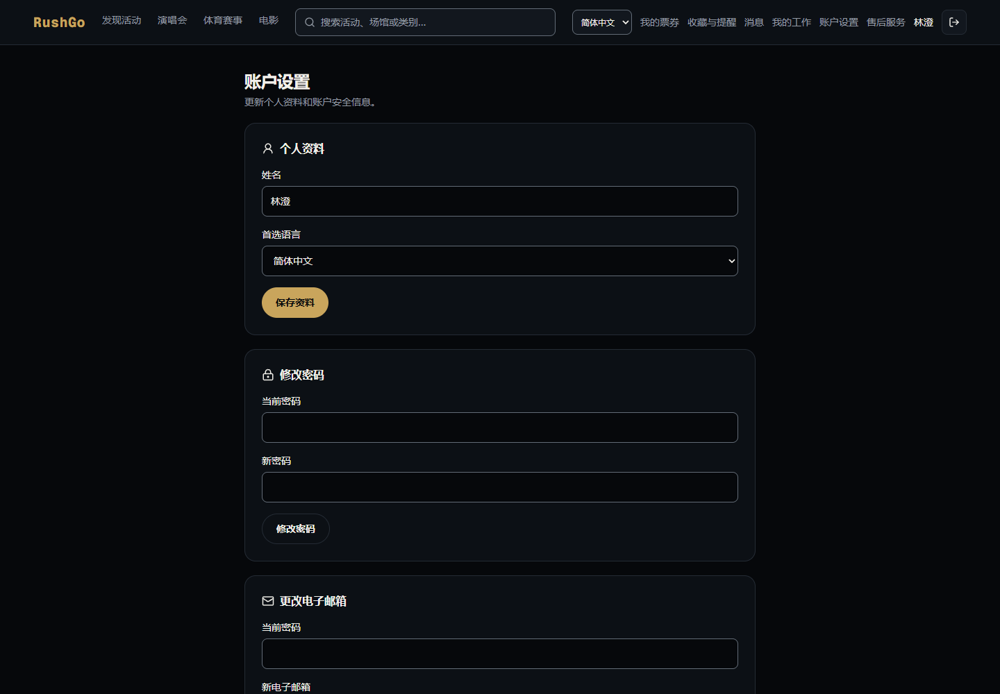

### After-Sales Service

`/aftersales` · Buyer · [Page source](../frontend/app/%28customer%29/aftersales/page.tsx)

Show buyer order-refund navigation and the entry point for event approvers.

- Personal orders and refund navigation
- Event refund-review entry point
- Notice that a review link does not grant permission

**Screenshot** — Static form. Shows navigation and a blank event-ID form. No refund request or approval decision was submitted.

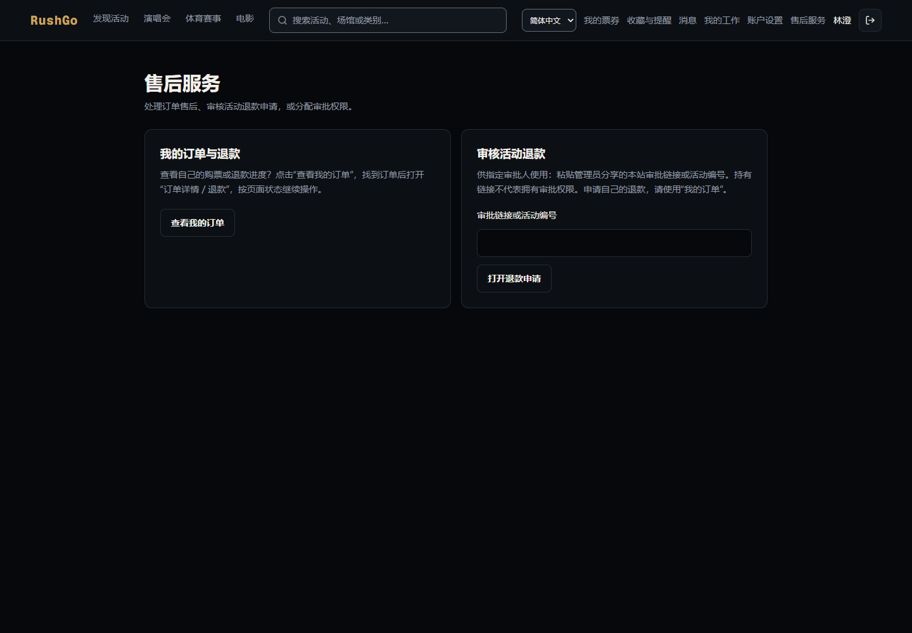

### Favorites and Alerts

`/favorites` · Buyer · [Page source](../frontend/app/%28customer%29/favorites/page.tsx)

View saved events and entry points for managing alert preferences.

- Saved event card
- Link to event details
- Alert and favorites controls

**Screenshot** — Local synthetic data. Shows a read-only favorites snapshot. No favorite, subscription, or email preference is changed.

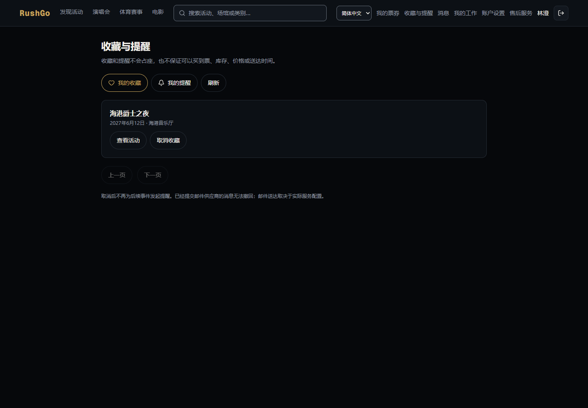

### My Tickets

`/my-tickets` · Buyer · [Page source](../frontend/app/%28customer%29/my-tickets/page.tsx)

View an issued ticket card and summaries for two event orders.

- Issued admission ticket card
- Confirmed A1 and pending A2 orders
- Links to order details and refunds

**Screenshot** — Local synthetic data. Read-only ticket card and two order summaries. Refund progress appears in order details. No temporary entry credential is generated, no refund is withdrawn, and no order is changed.

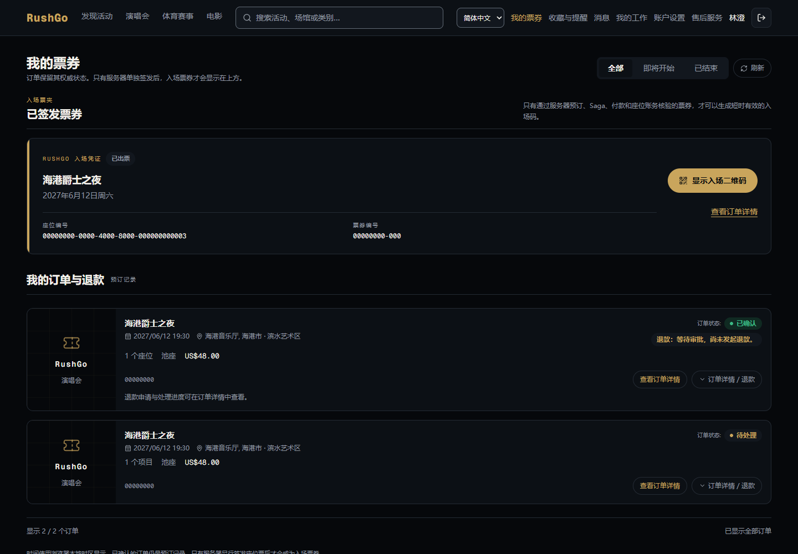

### Order Details

`/my-tickets/orders/[id]` · Buyer · [Page source](../frontend/app/%28customer%29/my-tickets/orders/%5Bid%5D/page.tsx)

View the order state, event details, ticket-issuance progress, and refund eligibility.

- Confirmed order amount and time
- A1 ticket issuance status
- Refund request state and full-order scope

**Screenshot** — Local synthetic data. Read-only snapshot of the confirmed A1 order. No refund is requested or withdrawn, and no temporary entry credential is generated.

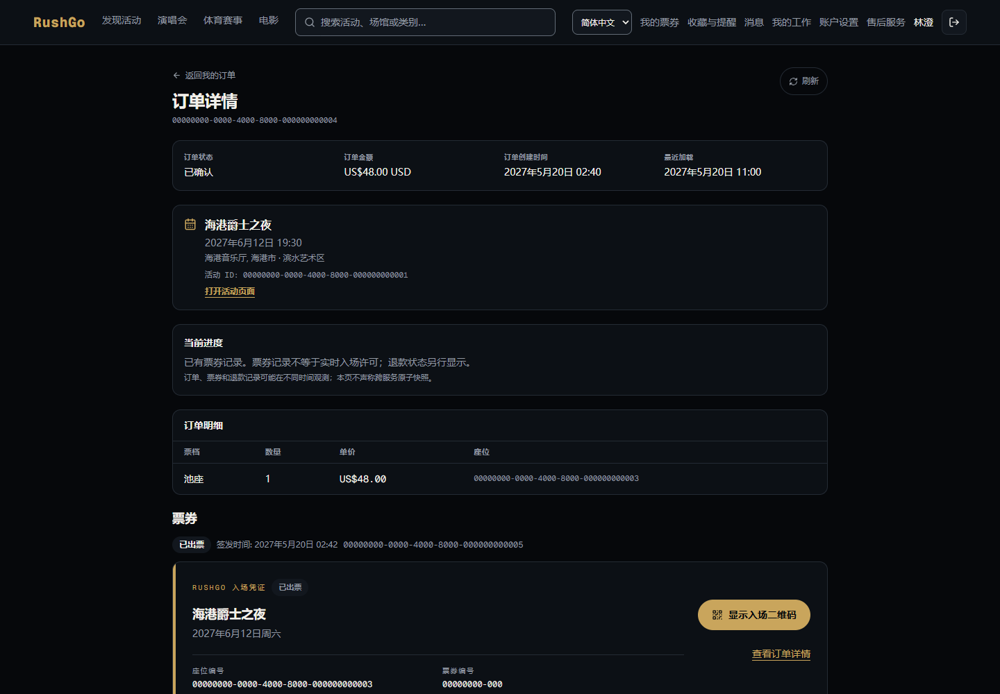

### Notifications

`/notifications` · Buyer · [Page source](../frontend/app/%28customer%29/notifications/page.tsx)

View order notifications, unread state, and the related order link.

- One unread order notification
- Notification time and content
- Link to the related order

**Screenshot** — Local synthetic data. Read-only inbox snapshot. The notification is not marked as read.

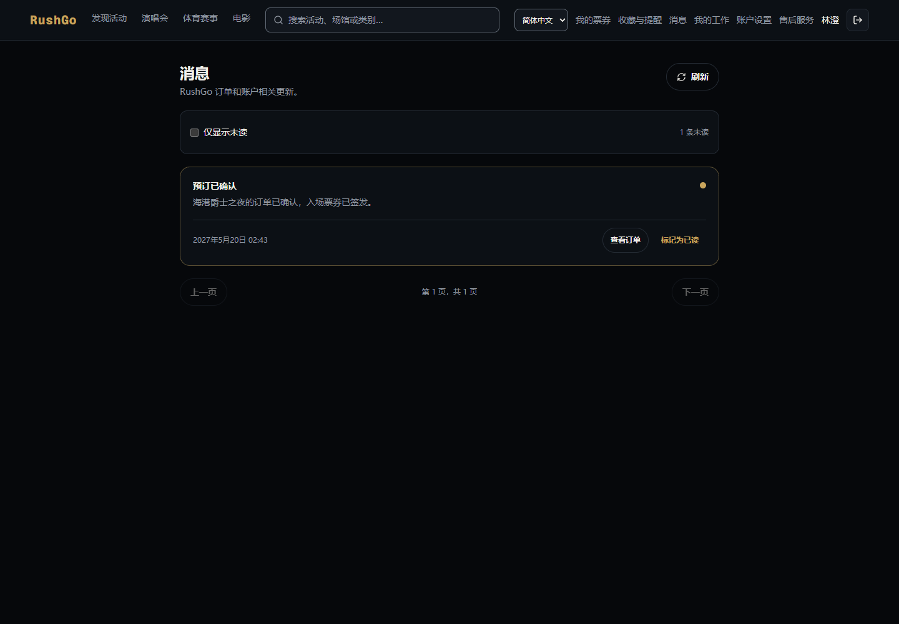

## Event Staff

### My Assignments

`/work` · Event staff · [Page source](../frontend/app/%28customer%29/work/page.tsx)

View assigned event tasks and the check-in entry point.

- Zhou Ning's scanner permission
- Harbor Jazz Night assignment
- Link to ticket check-in

**Screenshot** — Local synthetic data. Read-only staff assignment snapshot. No check-in flow was started and no ticket operation was performed.

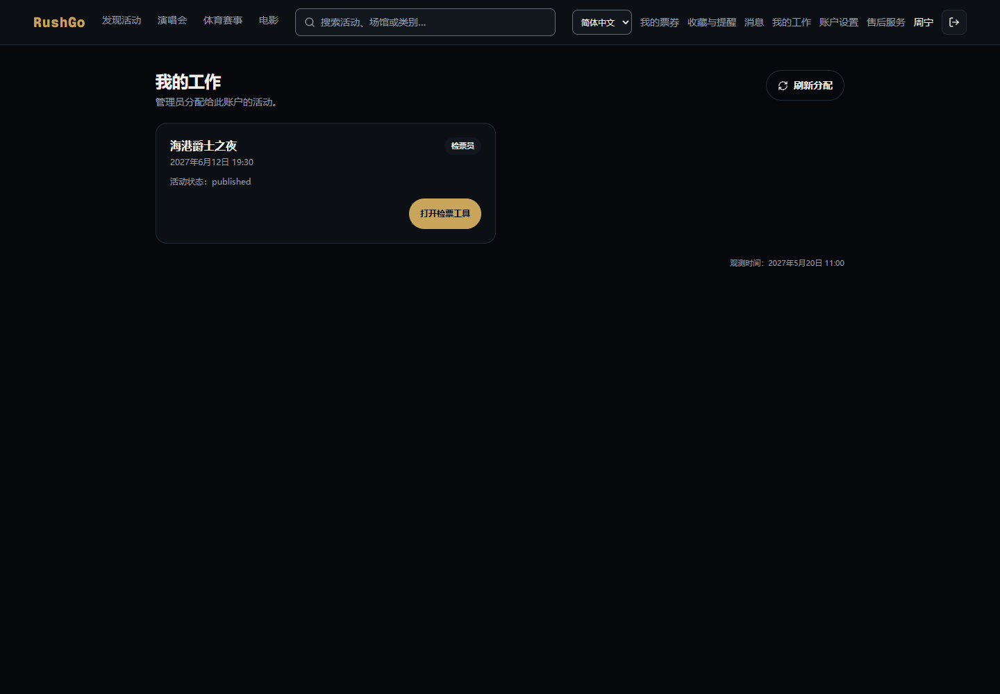

### Ticket Check-In

`/events/[id]/check-in` · Event staff · [Page source](../frontend/app/%28customer%29/events/%5Bid%5D/check-in/page.tsx)

Show the scan and manual credential entry points used for staff check-in.

- Online validation guidance
- Scan entry point
- Manual credential input

**Screenshot** — Static form. The scanner remains idle. No camera is enabled, no credential is entered, and no check-in request is submitted.

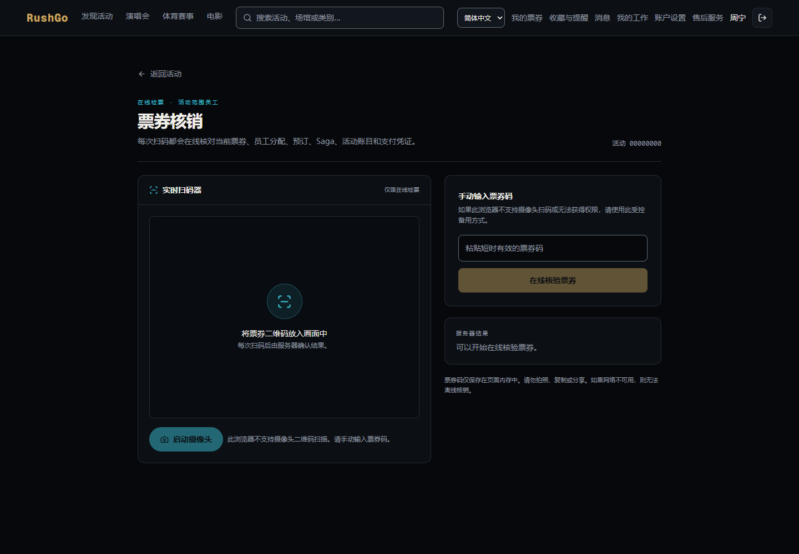

## Administration

### Overview

`/admin` · Administrator · [Page source](../frontend/app/admin/page.tsx)

View recent results from admin data sources and the available management entry points.

- Event and scheduled-job summaries
- Booking and notification outbox side by side
- Links to event, job, and outbox management

**Screenshot** — Local synthetic data. Shows one event, one scheduled job, and recorded order-confirmation and notification-adapter receipts.

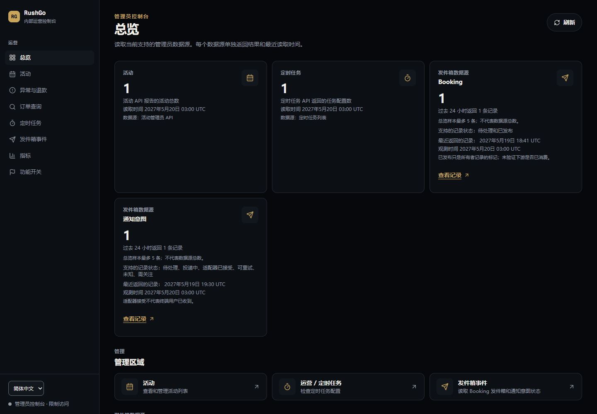

### Events

`/admin/events` · Administrator · [Page source](../frontend/app/admin/events/page.tsx)

Search events and review ticket tiers, sales status, and inventory.

- Filter by keyword and category
- Browse event records by page
- Open event operations and refund entry points

**Screenshot** — Local synthetic data. Harbor Jazz Night is on sale, with 23 stalls tickets available.

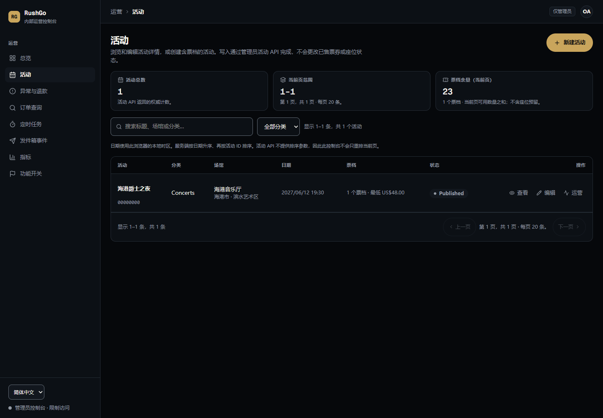

### Event Refund Review

`/admin/events/[id]/refunds` · Administrator · [Page source](../frontend/app/admin/events/%5Bid%5D/refunds/page.tsx)

Review refund requests for an event, the approval permissions, and each request state.

- View the refund queue for an event
- Check requested amounts and refund states
- View event refund approvers

**Screenshot** — Local synthetic data. One $48 request is awaiting review. The ticket has not been checked in, and no refund was issued.

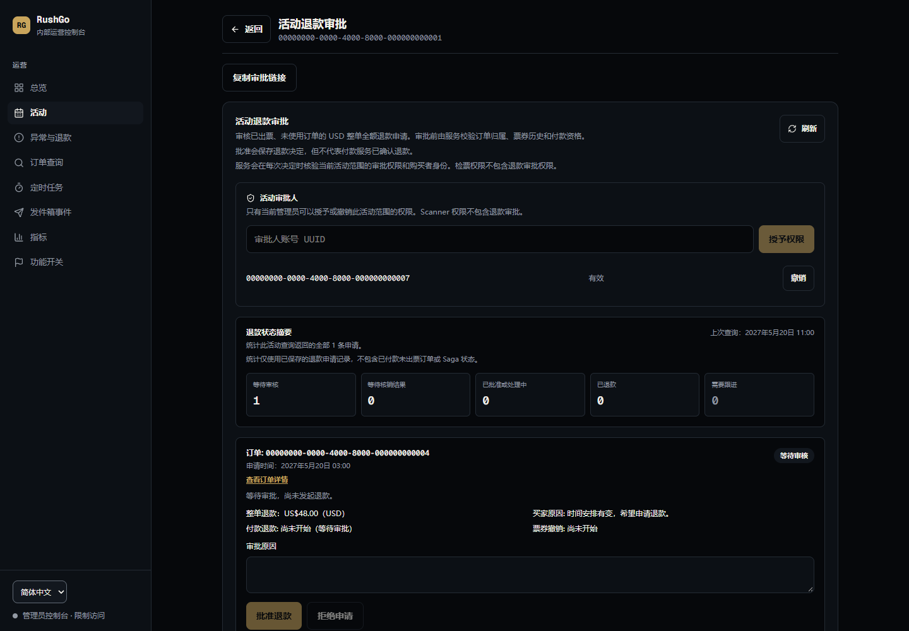

### Event Operations

`/admin/events/[id]/operations` · Administrator · [Page source](../frontend/app/admin/events/%5Bid%5D/operations/page.tsx)

View recorded snapshots of event sales, tickets, and check-ins.

- Counts of issued, checked-in, and revoked tickets
- Recorded state of an individual ticket
- Link to the event refund queue

**Screenshot** — Local synthetic data. One ticket is issued and seat A1 has not been checked in. A refund request remains under review.

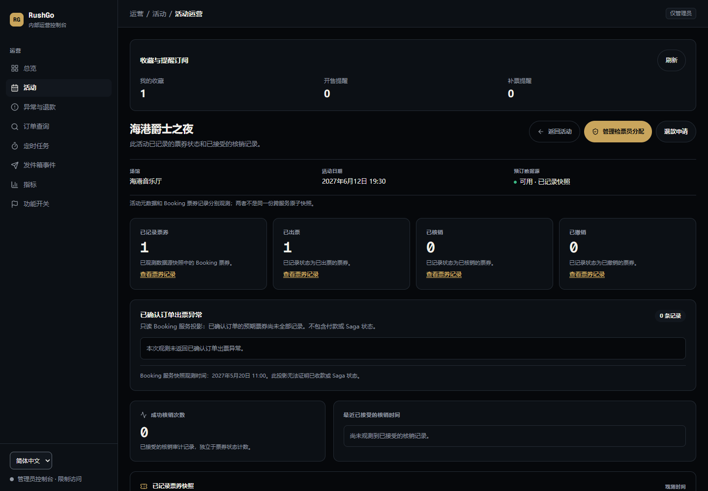

### Find an Order

`/admin/orders` · Administrator · [Page source](../frontend/app/admin/orders/page.tsx)

Look up one order and its after-sales details by the full Booking ID.

- Open details using the complete order UUID
- Validate incomplete or malformed UUIDs
- Return from order details to the lookup form

**Screenshot** — Local synthetic data. The form contains a sample order UUID but has not been submitted.

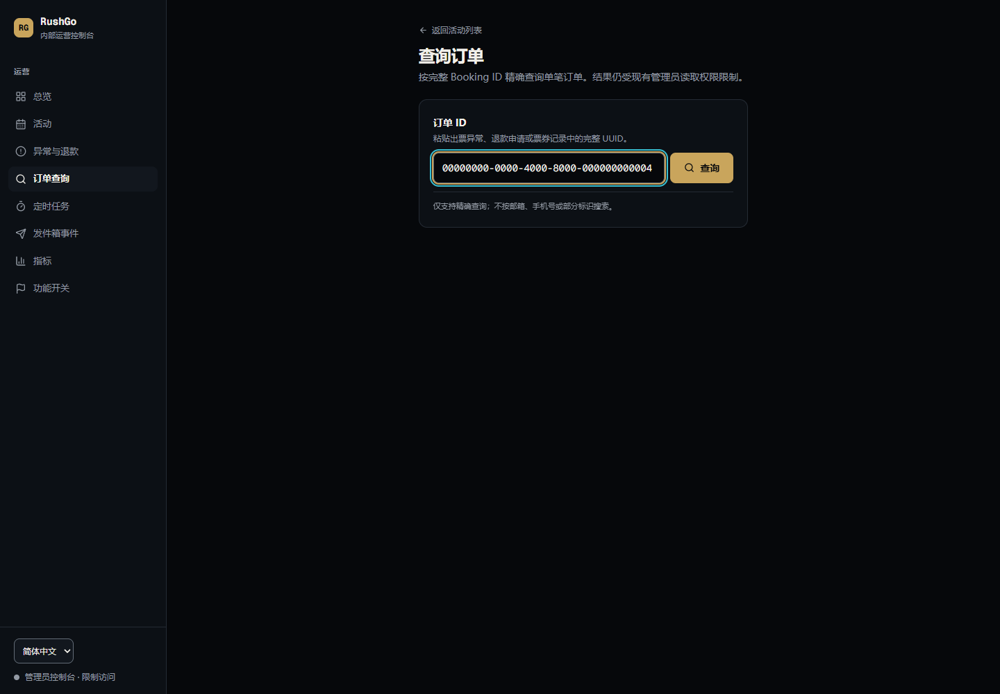

### Order and After-Sales Details

`/admin/orders/[id]` · Administrator · [Page source](../frontend/app/admin/orders/%5Bid%5D/page.tsx)

Look up the order owner, ticket tier, seat, issuance record, and refund state together.

- Confirmed order state and amount
- A1 ticket issuance and check-in records
- Pending refund review and its boundaries

**Screenshot** — Local synthetic data. Lin Cheng's order is confirmed; stalls seat A1 is issued and has not been checked in. The refund request is awaiting review.

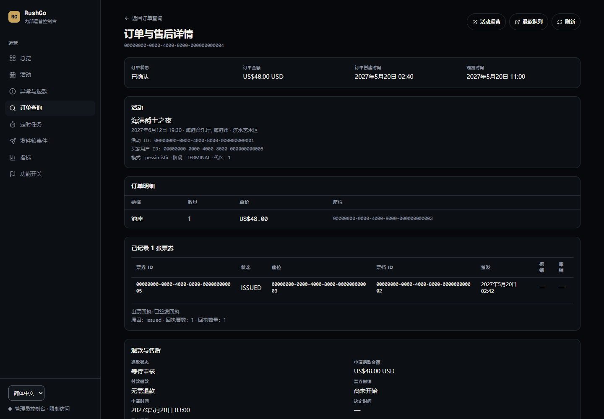

### Exceptions and Refunds

`/admin/operations` · Administrator · [Page source](../frontend/app/admin/operations/page.tsx)

Review service-reported order, refund, and notification exceptions over a time range.

- Distinguish order/payment and messaging data sources
- Show observation time and follow-up guidance
- Link to order details or refund records

**Screenshot** — Local synthetic data. The order and payment sources report one refund awaiting review. The notification exception list is empty, and its source is available.

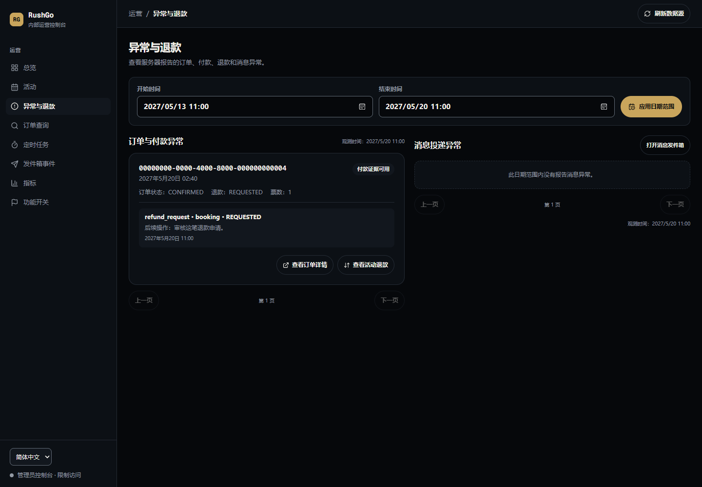

### Outbox Events

`/admin/outbox` · Administrator · [Page source](../frontend/app/admin/outbox/page.tsx)

View recorded outbox events by source, state, and time range.

- Filter by Booking or notification source
- Distinguish source-record state from downstream consumption
- Read events in paginated time windows

**Screenshot** — Local synthetic data. The notification service recorded one `booking_confirmation` event. Adapter acceptance does not confirm downstream consumption.

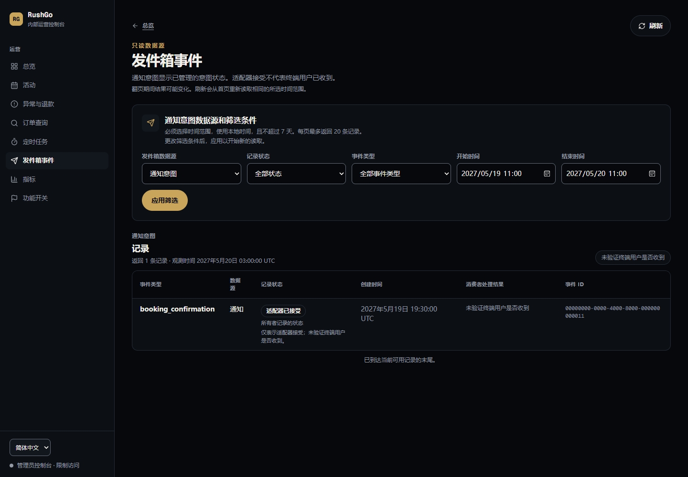

### Scheduled Jobs

`/admin/ops` · Administrator · [Page source](../frontend/app/admin/ops/page.tsx)

View scheduled-job configuration and the run plan in scheduler-service.

- Inspect six-field Cron expressions
- View job version, timeout, and state
- Filter jobs and view the creation entry point

**Screenshot** — Local synthetic data. The booking-expiry cleanup job is enabled and scheduled.

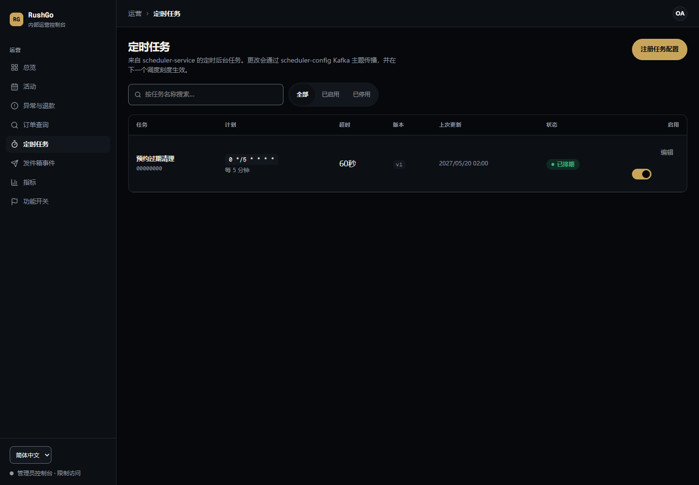

### Feature Flags

`/admin/flags` · Administrator · [Page source](../frontend/app/admin/flags/page.tsx)

View allowlisted presentation-feature settings and their change records.

- Read the advanced event discovery filter flag
- Show data source and observation time
- View recent audit records

**Screenshot** — Local synthetic data. Advanced public event discovery filters are disabled. No change history is recorded.

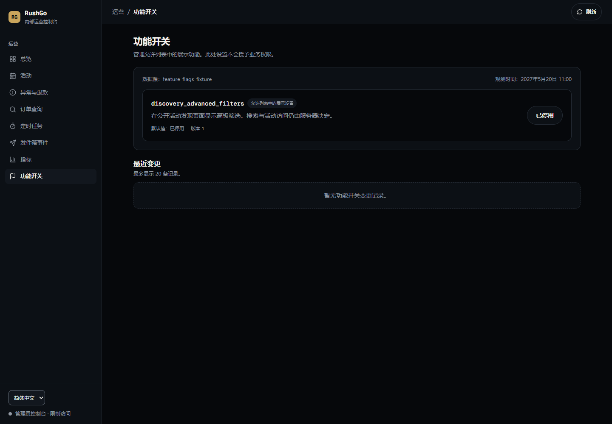

### Operations Metrics

`/admin/metrics` · Administrator · [Page source](../frontend/app/admin/metrics/page.tsx)

Review order, ticket, refund, and payment summaries over a selected time range.

- Mark Booking and Payment data sources separately
- Present known amounts by currency and TEST mode
- Apply the range and export CSV

**Screenshot** — Local synthetic data. The time range contains two orders, one issued ticket, and one $48 TEST collection. One refund request remains pending.

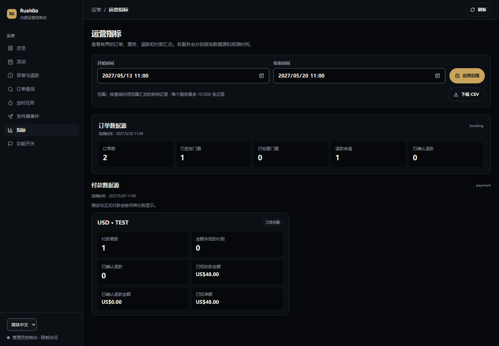

## Mobile

Three narrow-screen samples use the same components and data. They show how navigation, event information, and ticket actions are laid out on a phone. The screenshots retain the application's current Simplified Chinese UI.

### Event Discovery

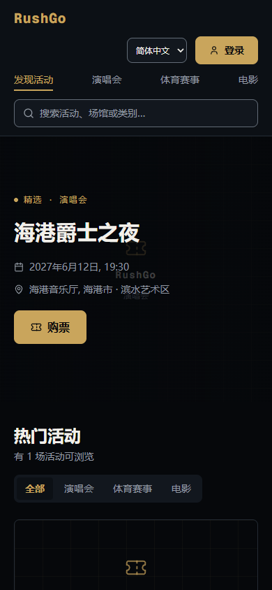

### Event Details

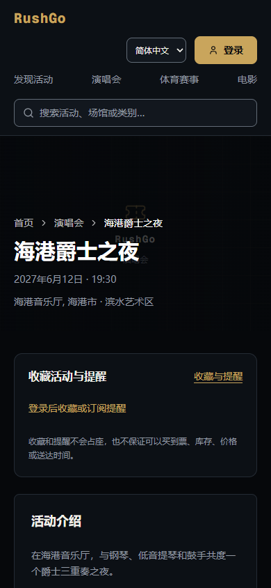

### My Tickets

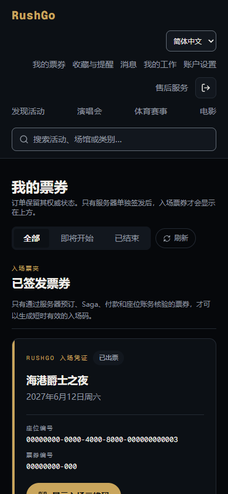
