# RushGo 页面图册

[简体中文](SCREENSHOTS.md) | [English](SCREENSHOTS.en.md)

从活动发现、预订和持票入场，到退款审批和运维查询，下表列出 Next.js 路由树中的全部页面。点击索引里的页面名可阅读功能说明，点击图片链接可查看原图。

截图由当前页面组件在本地 Chromium 浏览器渲染。动态页面共用海港爵士之夜的合成样例，购票人、活动工作人员和管理员分别使用独立的预览身份。索引中的“静态表单”指未提交的表单界面；受保护表单使用相应的合成身份。图中的金额、订单、票据和运营记录均为样例，付款、邮件、核销和审批没有实际执行。

桌面视口 1440 × 1000，移动视口 390 × 844，像素比为 1。界面使用简体中文、深色主题和上海时区。样例时钟固定于 2027 年 5 月 20 日 11:00。

[复现与交互预览](../DEMO.md) · [逐图来源清单](demo/screenshot-index.json) · [架构与业务流程](ARCHITECTURE.md)

## 页面索引

| 页面 | 路由 | 预览角色 | 截图 | 数据来源 | 覆盖 |
| --- | --- | --- | --- | --- | --- |
| [活动发现](#page-customer-discover) | `/` | 访客 | [桌面](demo/screenshots/customer/customer-discover.png) | 本地合成数据 | 已截图 |
| [活动详情](#page-customer-event-detail) | `/events/[id]` | 访客 | [桌面](demo/screenshots/customer/customer-event-detail.png) | 本地合成数据 | 已截图 |
| [在线选座](#page-customer-seat-selection) | `/events/[id]/seats` | 购票人 | [桌面](demo/screenshots/customer/customer-seat-selection.png) | 本地合成数据 | 已截图 |
| [继续现有订单](#page-customer-checkout-status) | `/checkout` | 购票人 | [桌面](demo/screenshots/customer/customer-checkout-status.png) | 本地合成数据 | 已截图 |
| [登录](#page-customer-login) | `/login` | 访客 | [桌面](demo/screenshots/customer/customer-login.png) | 静态表单 | 已截图 |
| [创建账号](#page-customer-register) | `/register` | 访客 | [桌面](demo/screenshots/customer/customer-register.png) | 静态表单 | 已截图 |
| [忘记密码](#page-customer-forgot-password) | `/forgot-password` | 访客 | [桌面](demo/screenshots/customer/customer-forgot-password.png) | 静态表单 | 已截图 |
| [重置密码](#page-customer-reset-password) | `/reset-password` | 访客 | [桌面](demo/screenshots/customer/customer-reset-password.png) | 静态表单 | 已截图 |
| [账户设置](#page-customer-account) | `/account` | 购票人 | [桌面](demo/screenshots/customer/customer-account.png) | 本地合成数据 | 已截图 |
| [售后服务](#page-customer-aftersales) | `/aftersales` | 购票人 | [桌面](demo/screenshots/customer/customer-aftersales.png) | 静态表单 | 已截图 |
| [收藏与提醒](#page-customer-favorites) | `/favorites` | 购票人 | [桌面](demo/screenshots/customer/customer-favorites.png) | 本地合成数据 | 已截图 |
| [我的票券](#page-customer-ticket-wallet) | `/my-tickets` | 购票人 | [桌面](demo/screenshots/customer/customer-ticket-wallet.png) | 本地合成数据 | 已截图 |
| [订单详情](#page-customer-order-detail) | `/my-tickets/orders/[id]` | 购票人 | [桌面](demo/screenshots/customer/customer-order-detail.png) | 本地合成数据 | 已截图 |
| [消息](#page-customer-notifications) | `/notifications` | 购票人 | [桌面](demo/screenshots/customer/customer-notifications.png) | 本地合成数据 | 已截图 |
| [我的工作](#page-customer-staff-work) | `/work` | 活动工作人员 | [桌面](demo/screenshots/customer/customer-staff-work.png) | 本地合成数据 | 已截图 |
| [票券核销](#page-customer-staff-check-in) | `/events/[id]/check-in` | 活动工作人员 | [桌面](demo/screenshots/customer/customer-staff-check-in.png) | 静态表单 | 已截图 |
| [总览](#page-admin-overview) | `/admin` | 管理员 | [桌面](demo/screenshots/admin/admin-overview.png) | 本地合成数据 | 已截图 |
| [活动](#page-admin-events) | `/admin/events` | 管理员 | [桌面](demo/screenshots/admin/admin-events.png) | 本地合成数据 | 已截图 |
| [活动退款审批](#page-admin-event-refunds) | `/admin/events/[id]/refunds` | 管理员 | [桌面](demo/screenshots/admin/admin-event-refunds.png) | 本地合成数据 | 已截图 |
| [活动运营](#page-admin-event-operations) | `/admin/events/[id]/operations` | 管理员 | [桌面](demo/screenshots/admin/admin-event-operations.png) | 本地合成数据 | 已截图 |
| [查询订单](#page-admin-order-lookup) | `/admin/orders` | 管理员 | [桌面](demo/screenshots/admin/admin-order-lookup.png) | 本地合成数据 | 已截图 |
| [订单与售后详情](#page-admin-order-detail) | `/admin/orders/[id]` | 管理员 | [桌面](demo/screenshots/admin/admin-order-detail.png) | 本地合成数据 | 已截图 |
| [异常与退款](#page-admin-exceptions-refunds) | `/admin/operations` | 管理员 | [桌面](demo/screenshots/admin/admin-exceptions-refunds.png) | 本地合成数据 | 已截图 |
| [发件箱事件](#page-admin-outbox) | `/admin/outbox` | 管理员 | [桌面](demo/screenshots/admin/admin-outbox.png) | 本地合成数据 | 已截图 |
| [定时任务](#page-admin-scheduler-jobs) | `/admin/ops` | 管理员 | [桌面](demo/screenshots/admin/admin-scheduler-jobs.png) | 本地合成数据 | 已截图 |
| [功能开关](#page-admin-feature-flags) | `/admin/flags` | 管理员 | [桌面](demo/screenshots/admin/admin-feature-flags.png) | 本地合成数据 | 已截图 |
| [运营指标](#page-admin-metrics) | `/admin/metrics` | 管理员 | [桌面](demo/screenshots/admin/admin-metrics.png) | 本地合成数据 | 已截图 |

## 观众与购票人

### 活动发现

`/` · 访客 · [页面源码](../frontend/app/%28customer%29/page.tsx)

查看公开活动、票档价格和场馆信息。

- 海港爵士之夜活动卡片
- 公开活动搜索与分类入口
- 活动日期、场馆和票价摘要

**截图说明**　本地合成数据。中文只读活动样例；不涉及账号、预订或支付。

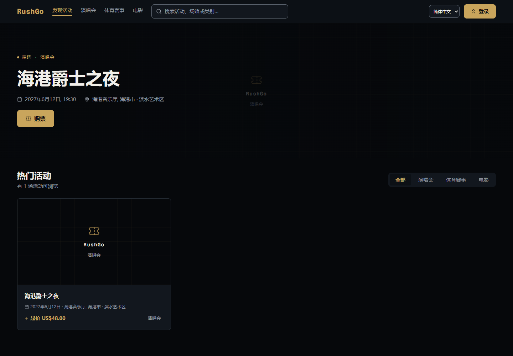

### 活动详情

`/events/[id]` · 访客 · [页面源码](../frontend/app/%28customer%29/events/%5Bid%5D/page.tsx)

展示活动介绍、时间地点、票档价格和选座入口。

- 活动介绍与场馆信息
- 池座价格及可售数量
- 前往座位图的入口

**截图说明**　本地合成数据。只读公开活动数据；选座后仍需服务端确认实时库存。

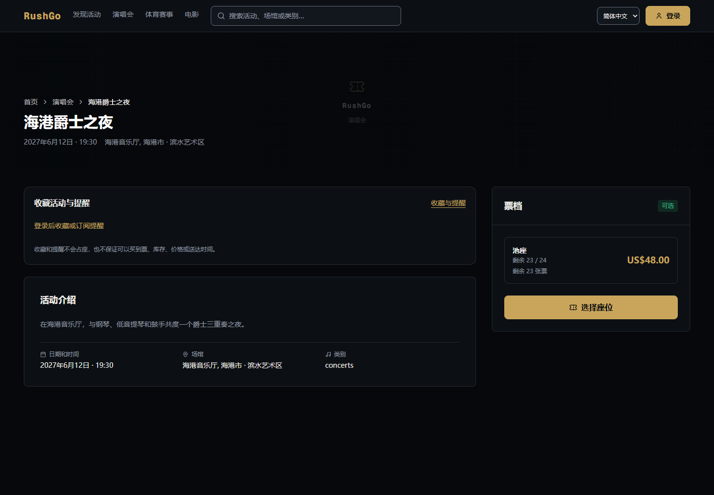

### 在线选座

`/events/[id]/seats` · 购票人 · [页面源码](../frontend/app/%28customer%29/events/%5Bid%5D/seats/page.tsx)

查看由座位快照和实时流共同确认的座位状态，并选中一个可售座位。

- 24 个池座位置
- A1 已售出、A2 可选
- 选中座位和金额摘要
- 实时库存连接状态

**截图说明**　本地合成数据。展示 A2 的本地样例选择；未继续结账、创建订单或预留座位。

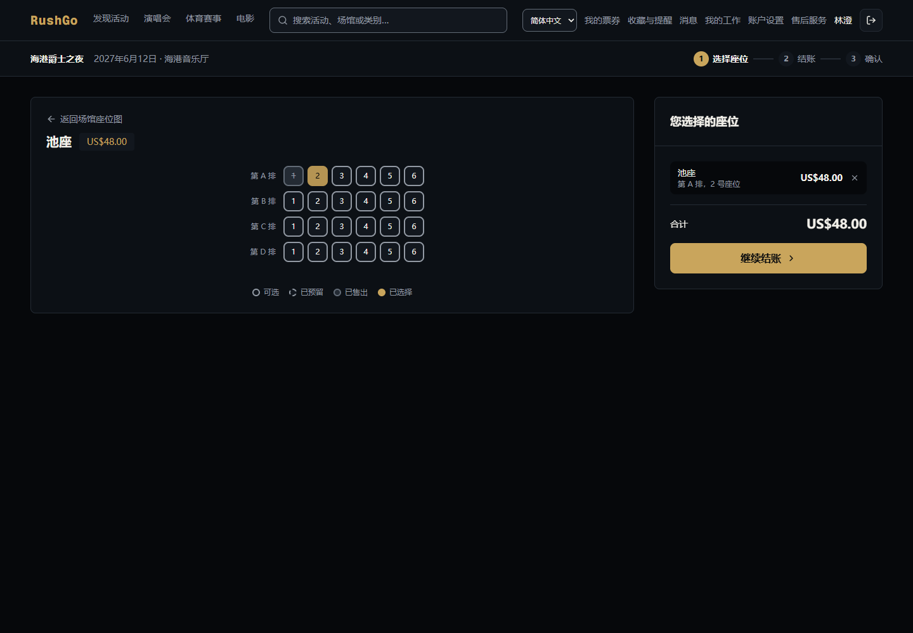

### 继续现有订单

`/checkout` · 购票人 · [页面源码](../frontend/app/%28customer%29/checkout/page.tsx)

查看既有订单的付款处理状态和安全的后续查询入口。

- 订单号和订单金额
- 付款处理中状态
- 查看订单和重新查询入口

**截图说明**　本地合成数据。仅回放 A2 预留前订单的处理中快照；本地拦截恢复请求，不转发到服务端，不提供 Stripe 表单或支付凭据。

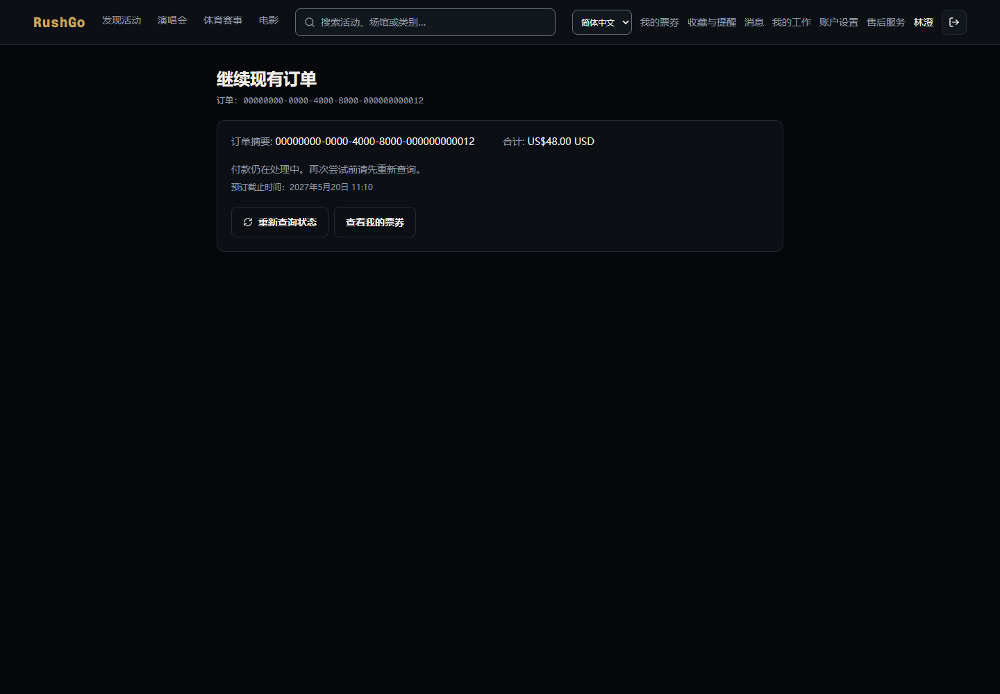

### 登录

`/login` · 访客 · [页面源码](../frontend/app/%28customer%29/login/page.tsx)

查看登录表单和安全的返回路径。

- 邮箱和密码输入
- 忘记密码入口
- 注册入口

**截图说明**　静态表单。仅展示空白表单；不提交登录信息，也不创建会话。

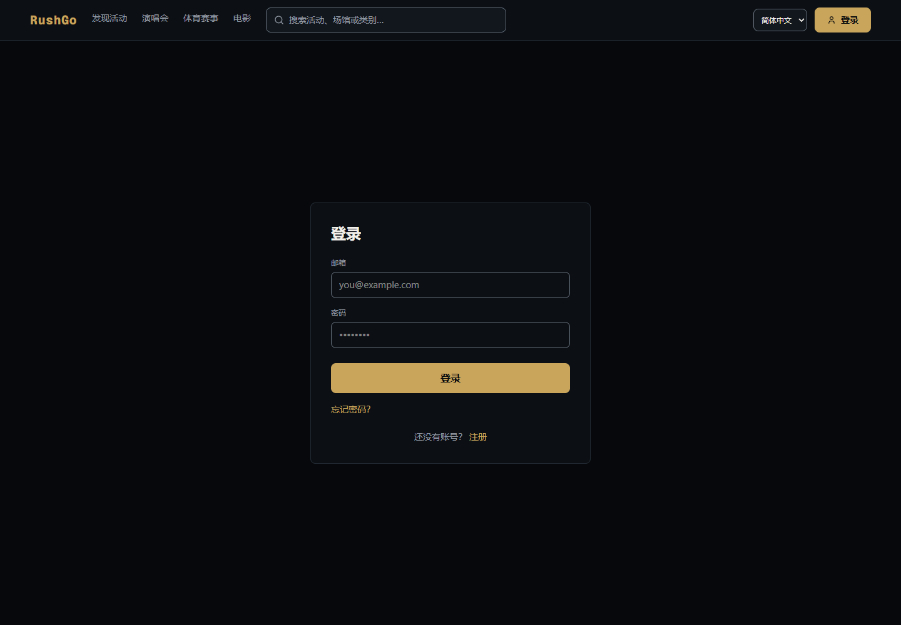

### 创建账号

`/register` · 访客 · [页面源码](../frontend/app/%28customer%29/register/page.tsx)

查看注册、邮箱验证码和密码规则的表单入口。

- 姓名与邮箱字段
- 获取注册验证码入口
- 密码确认字段

**截图说明**　静态表单。仅展示未提交的注册表单；未请求验证码或创建账号。

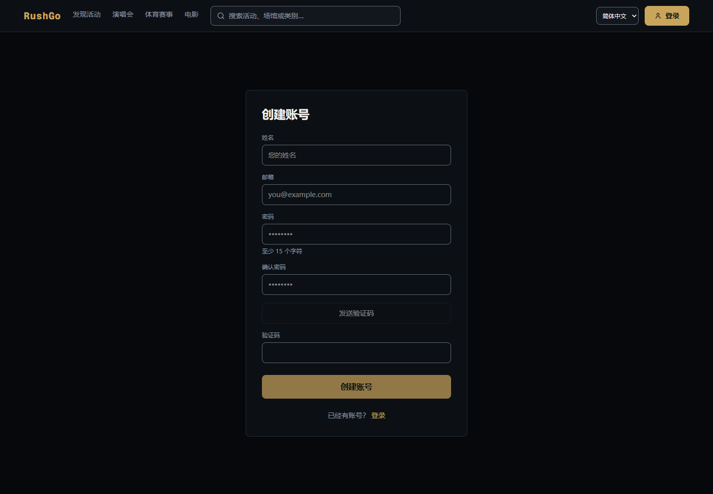

### 忘记密码

`/forgot-password` · 访客 · [页面源码](../frontend/app/%28customer%29/forgot-password/page.tsx)

查看密码找回请求所需的邮箱表单。

- 邮箱输入
- 提交找回请求的入口
- 返回登录入口

**截图说明**　静态表单。仅展示未提交表单；未请求或发送密码重置邮件。

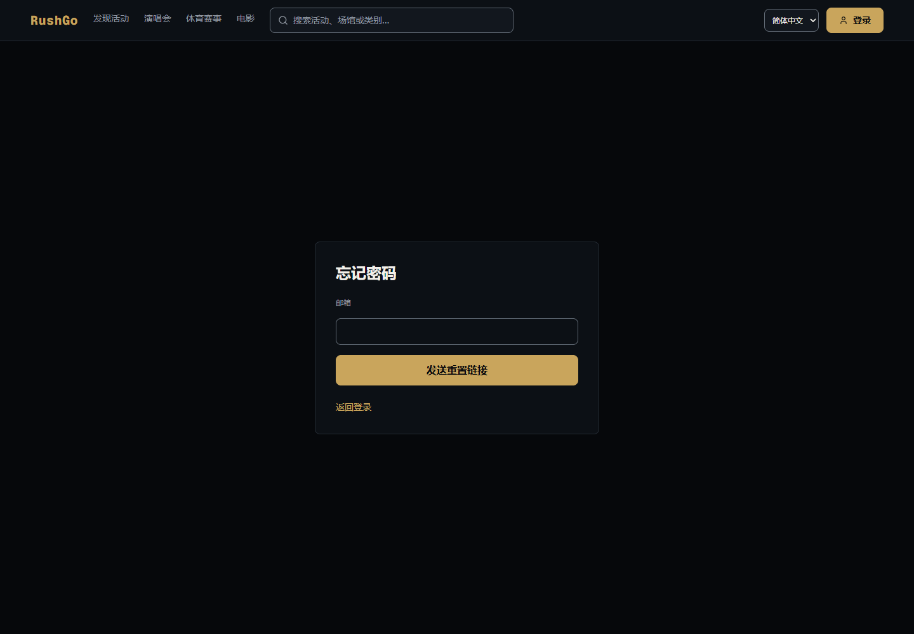

### 重置密码

`/reset-password` · 访客 · [页面源码](../frontend/app/%28customer%29/reset-password/page.tsx)

展示安全的重置表单边界和重新获取有效邮件链接的入口。

- 新密码与确认输入
- 密码长度提示
- 获取新重置链接入口

**截图说明**　静态表单。不使用可验证的重置 token；表单保持禁用，不提交密码变更。

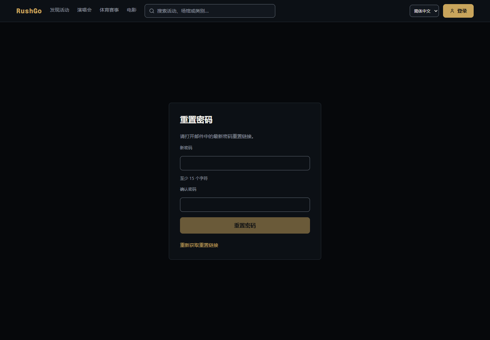

### 账户设置

`/account` · 购票人 · [页面源码](../frontend/app/%28customer%29/account/page.tsx)

查看当前账户资料、语言偏好和安全设置入口。

- 林澄的账户资料
- 简体中文语言偏好
- 密码与邮箱更新表单

**截图说明**　本地合成数据。资料由只读用户快照填充；不保存资料、不请求验证码或变更安全凭据。

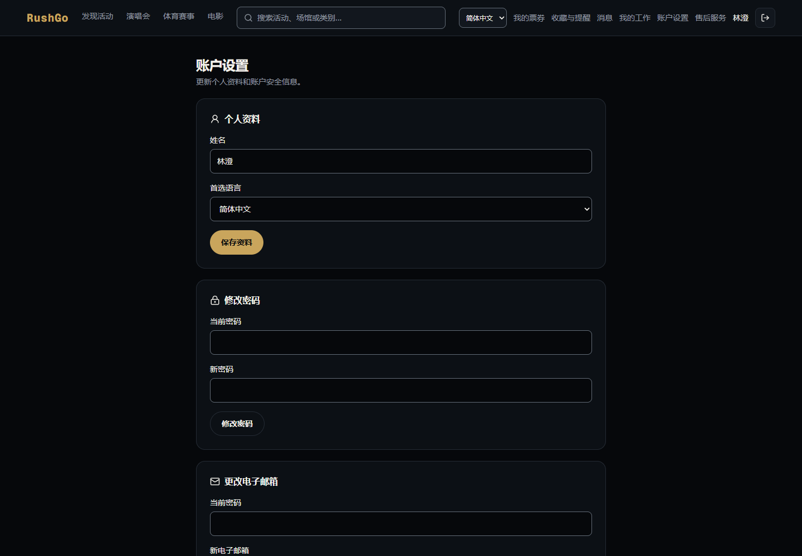

### 售后服务

`/aftersales` · 购票人 · [页面源码](../frontend/app/%28customer%29/aftersales/page.tsx)

说明买家订单退款入口与活动审批人工作入口。

- 个人订单和退款导航
- 活动退款审批入口
- 审批链接不授予权限的提示

**截图说明**　静态表单。仅展示导航和空白活动编号表单；没有提交退款申请或审批决定。

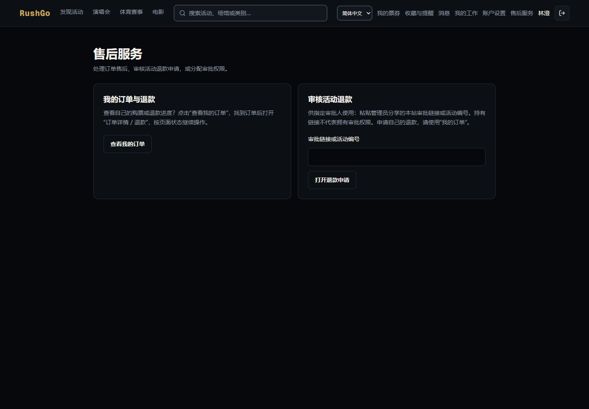

### 收藏与提醒

`/favorites` · 购票人 · [页面源码](../frontend/app/%28customer%29/favorites/page.tsx)

查看已收藏活动和提醒偏好管理入口。

- 已收藏活动卡片
- 活动详情入口
- 提醒和收藏管理控件

**截图说明**　本地合成数据。只读收藏快照；不会取消收藏、订阅或变更邮件偏好。

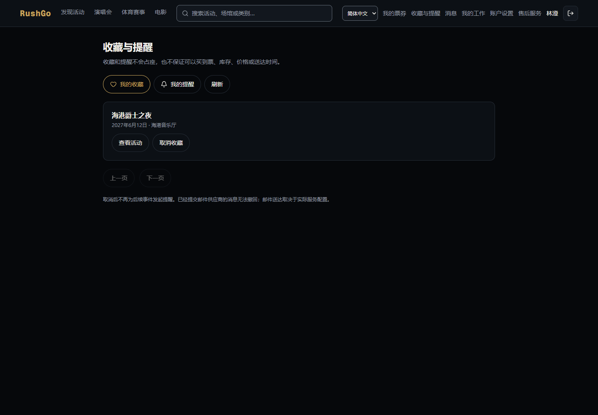

### 我的票券

`/my-tickets` · 购票人 · [页面源码](../frontend/app/%28customer%29/my-tickets/page.tsx)

查看已签发票券卡片和两条活动订单摘要。

- 已签发入场票券卡片
- A1 已确认与 A2 待处理订单
- 订单详情与退款入口

**截图说明**　本地合成数据。只读票券卡片和两条订单摘要；退款进度在订单详情查看。未生成临时入场码、撤回退款或修改订单。

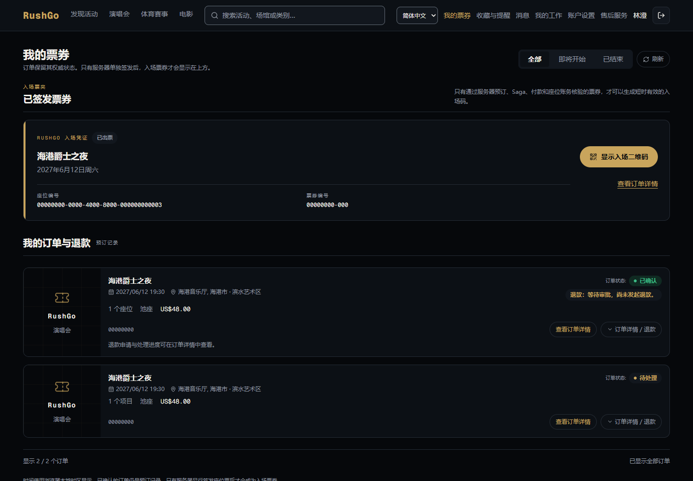

### 订单详情

`/my-tickets/orders/[id]` · 购票人 · [页面源码](../frontend/app/%28customer%29/my-tickets/orders/%5Bid%5D/page.tsx)

查看订单状态、活动信息、出票进度和退款资格状态。

- 已确认订单金额与时间
- A1 票券签发状态
- 退款申请状态和整单范围说明

**截图说明**　本地合成数据。只读 A1 已确认订单快照；未申请或撤回退款，也未生成临时入场码。

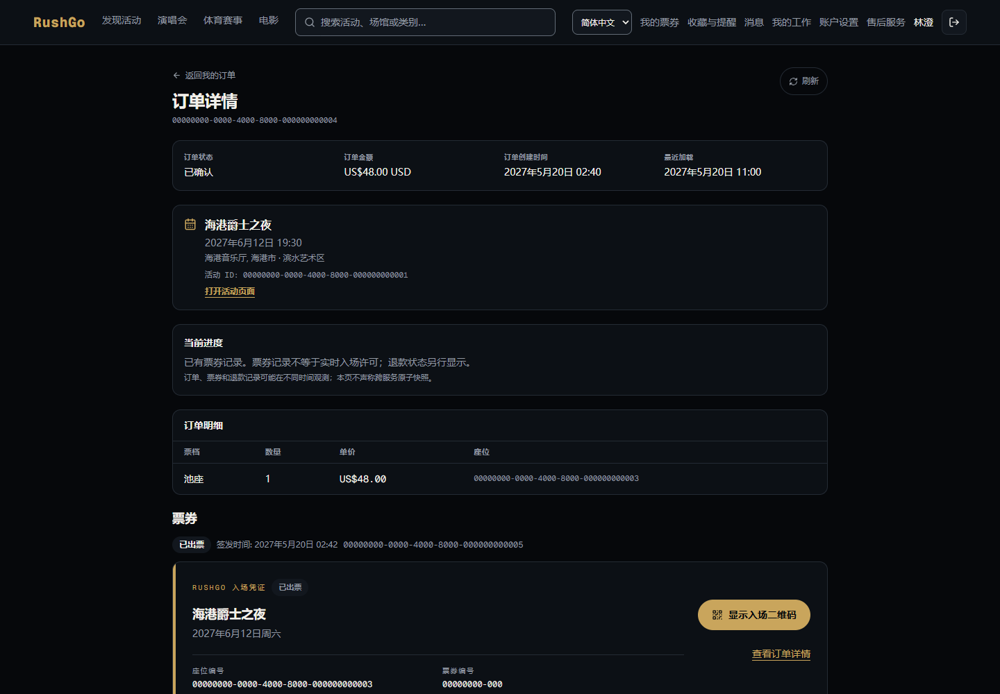

### 消息

`/notifications` · 购票人 · [页面源码](../frontend/app/%28customer%29/notifications/page.tsx)

查看订单通知、未读状态和对应订单入口。

- 一条未读订单通知
- 通知时间和正文
- 查看关联订单入口

**截图说明**　本地合成数据。只读通知收件箱快照；未将通知标记为已读。

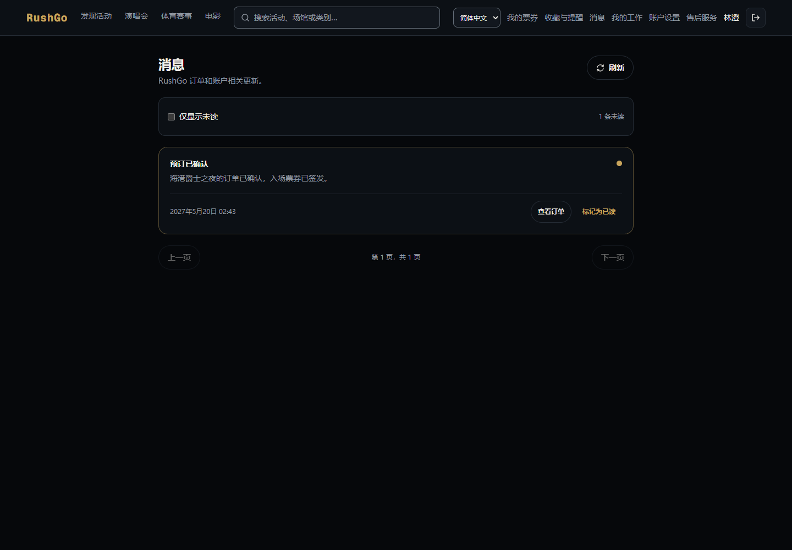

## 工作人员

### 我的工作

`/work` · 活动工作人员 · [页面源码](../frontend/app/%28customer%29/work/page.tsx)

查看工作人员获得授权的活动任务和扫码入口。

- 周宁的扫码权限
- 海港爵士之夜活动任务
- 进入票券核销页面

**截图说明**　本地合成数据。只读工作人员任务快照；未进入核销流程或执行票券操作。

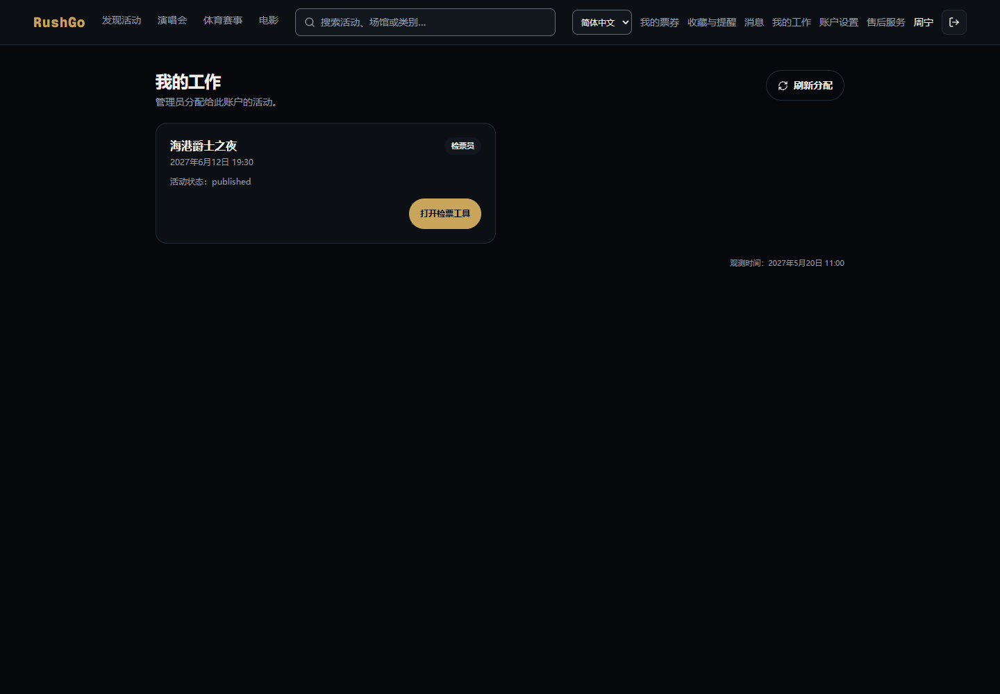

### 票券核销

`/events/[id]/check-in` · 活动工作人员 · [页面源码](../frontend/app/%28customer%29/events/%5Bid%5D/check-in/page.tsx)

展示工作人员在线核销票券所需的扫描和手工凭证入口。

- 在线核验说明
- 扫码入口
- 手工凭证输入

**截图说明**　静态表单。扫描器保持待命；未启用摄像头、输入凭证或提交核销请求。

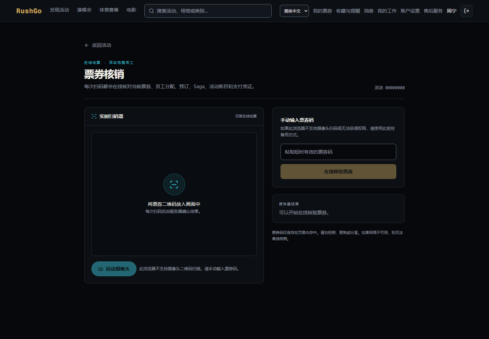

## 管理端

### 总览

`/admin` · 管理员 · [页面源码](../frontend/app/admin/page.tsx)

查看管理员数据源的近期读取结果和管理入口。

- 读取活动和定时任务概况
- 并列查看 Booking 与通知发件箱
- 前往活动、任务和发件箱管理

**截图说明**　本地合成数据。展示一个活动、一个定时任务，以及已发布的订单确认和通知适配器回执。

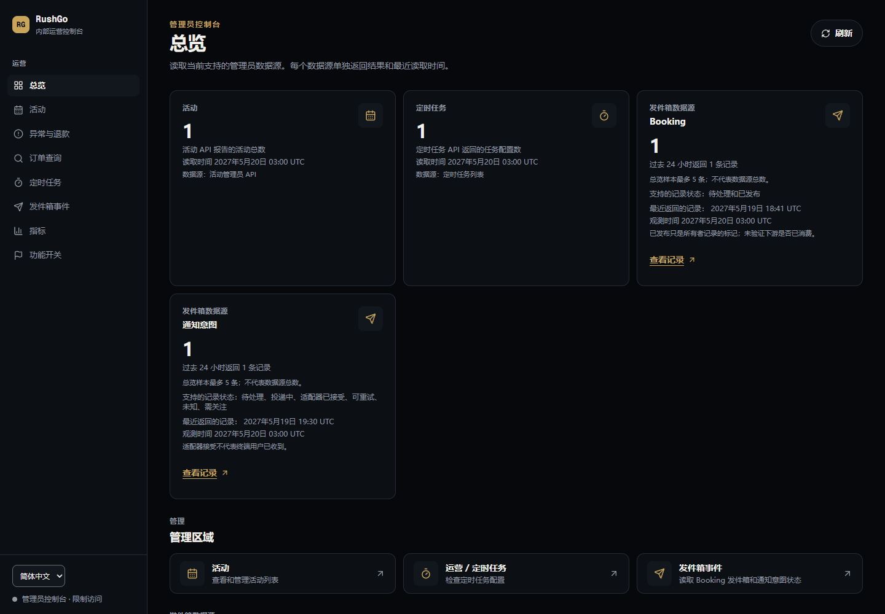

### 活动

`/admin/events` · 管理员 · [页面源码](../frontend/app/admin/events/page.tsx)

检索活动列表并查看票档、售票状态和库存。

- 按关键词和分类筛选
- 按页查看活动记录
- 打开活动运营和退款入口

**截图说明**　本地合成数据。海港爵士之夜正在售票，池座余量为 23 张。

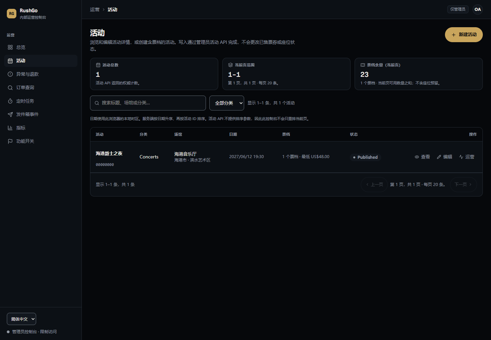

### 活动退款审批

`/admin/events/[id]/refunds` · 管理员 · [页面源码](../frontend/app/admin/events/%5Bid%5D/refunds/page.tsx)

查看该活动的退款申请、审批权限和申请状态。

- 按活动查看退款队列
- 核对申请金额和退款状态
- 查看活动退款审批人员

**截图说明**　本地合成数据。一笔 48 美元申请正在等待审批，票券尚未核销，未执行退款。

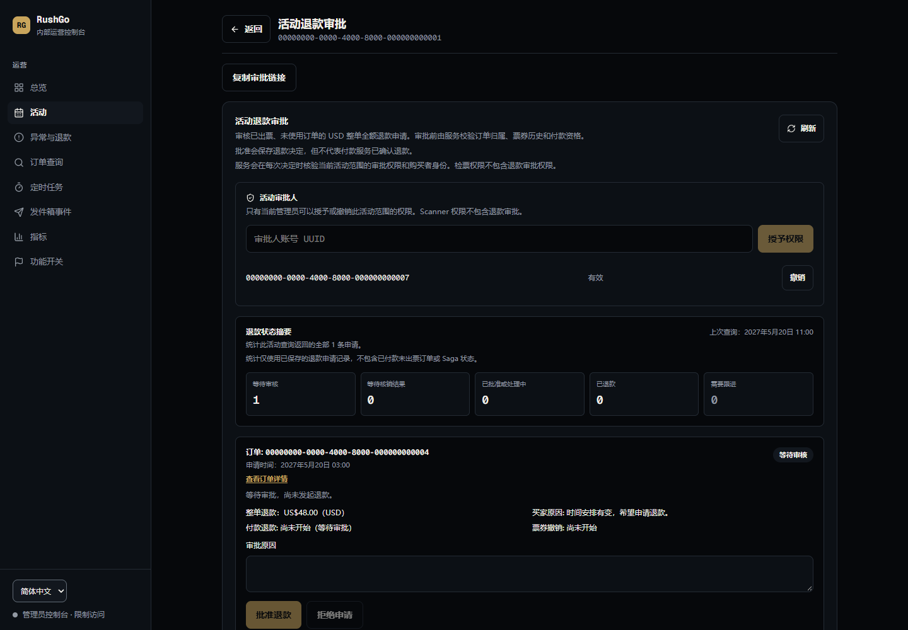

### 活动运营

`/admin/events/[id]/operations` · 管理员 · [页面源码](../frontend/app/admin/events/%5Bid%5D/operations/page.tsx)

查看活动已记录的售票、票券和核销快照。

- 统计已签发、已核销和已撤销票券
- 查看单张票券的记录状态
- 打开活动退款队列

**截图说明**　本地合成数据。已签发 1 张票券，座位 A1 尚未入场核销；退款申请仍待审批。

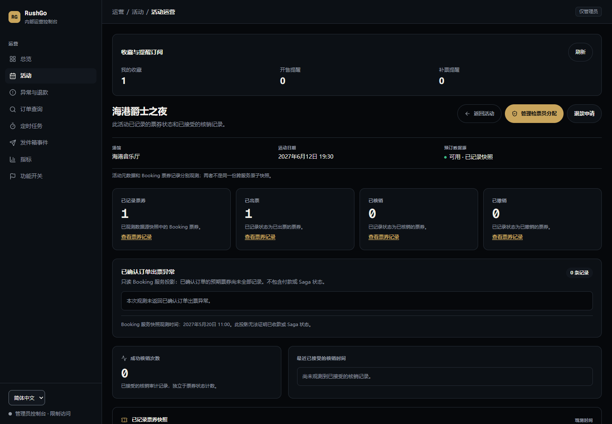

### 查询订单

`/admin/orders` · 管理员 · [页面源码](../frontend/app/admin/orders/page.tsx)

使用完整 Booking ID 精确查询一笔订单和售后详情。

- 输入完整订单 UUID 后打开详情
- 校验不完整或格式错误的 UUID
- 从订单详情返回查询表单

**截图说明**　本地合成数据。表单已预填样例订单 UUID；尚未提交查询。

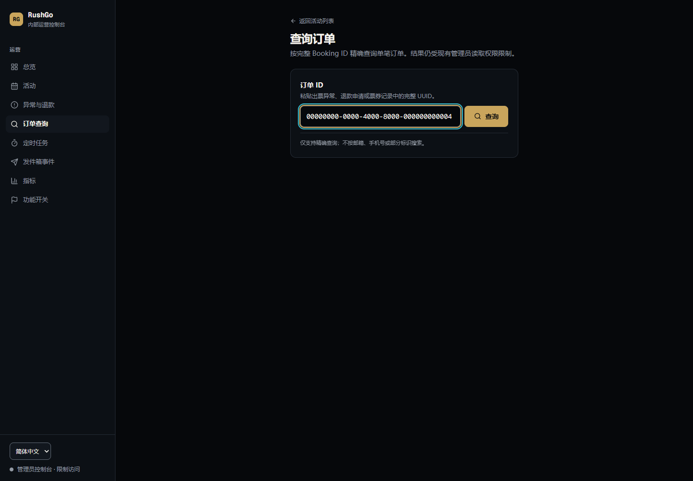

### 订单与售后详情

`/admin/orders/[id]` · 管理员 · [页面源码](../frontend/app/admin/orders/%5Bid%5D/page.tsx)

联查订单归属、票档、座位、出票记录和退款状态。

- 展示订单确认状态与金额
- 核对 A1 票券的出票和入场记录
- 查看待审批退款及其边界说明

**截图说明**　本地合成数据。林澄的订单已确认，池座 A1 已出票且未核销；退款申请正在等待审批。

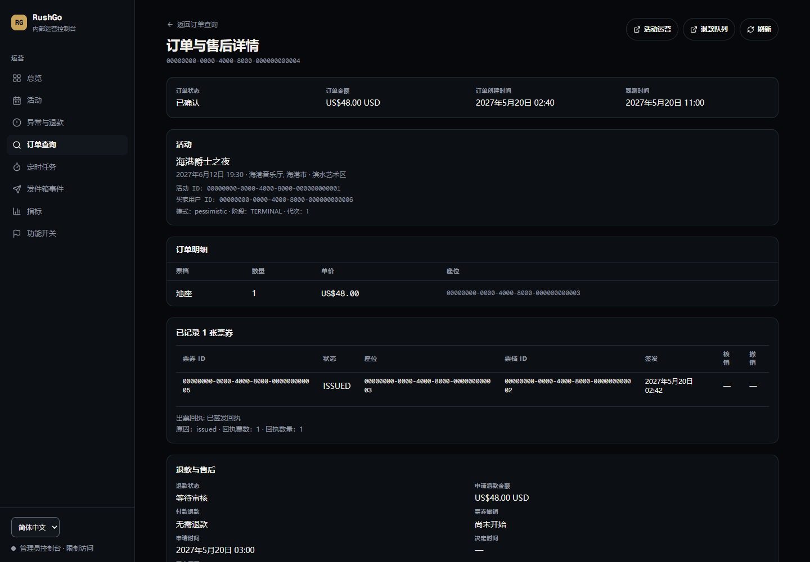

### 异常与退款

`/admin/operations` · 管理员 · [页面源码](../frontend/app/admin/operations/page.tsx)

按时间范围查看服务报告的订单、退款和通知异常。

- 区分订单付款与消息数据源
- 显示观察时间和后续处理建议
- 跳转到订单详情或退款记录

**截图说明**　本地合成数据。订单与付款数据源报告一笔待审批退款；通知异常列表为空且数据源可用。

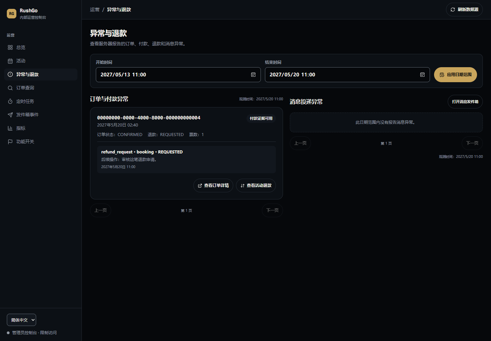

### 发件箱事件

`/admin/outbox` · 管理员 · [页面源码](../frontend/app/admin/outbox/page.tsx)

按来源、状态和时间范围查看发件箱的已记录事件。

- 筛选 Booking 或通知来源
- 明确区分来源记录状态和下游消费结果
- 按时间窗口分页读取

**截图说明**　本地合成数据。通知服务记录了一条 booking_confirmation；适配器已接受不代表下游消费已验证。

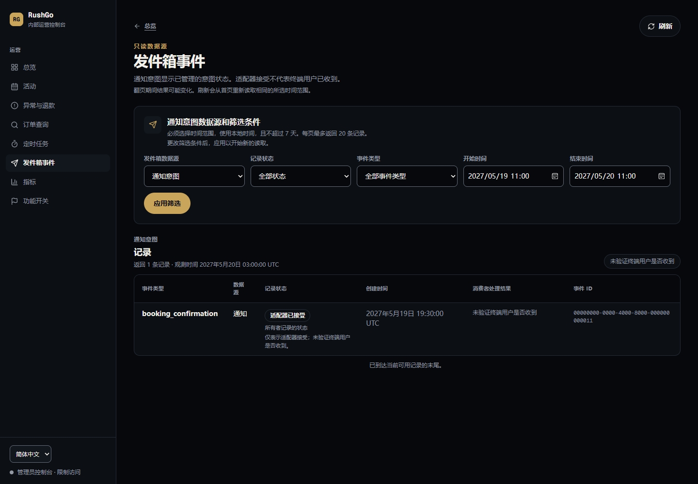

### 定时任务

`/admin/ops` · 管理员 · [页面源码](../frontend/app/admin/ops/page.tsx)

查看 scheduler-service 中的定时任务配置和运行计划。

- 检查六字段 Cron 表达式
- 查看任务版本、超时和状态
- 筛选任务并查看创建入口

**截图说明**　本地合成数据。预约过期清理任务有效并处于排期状态。

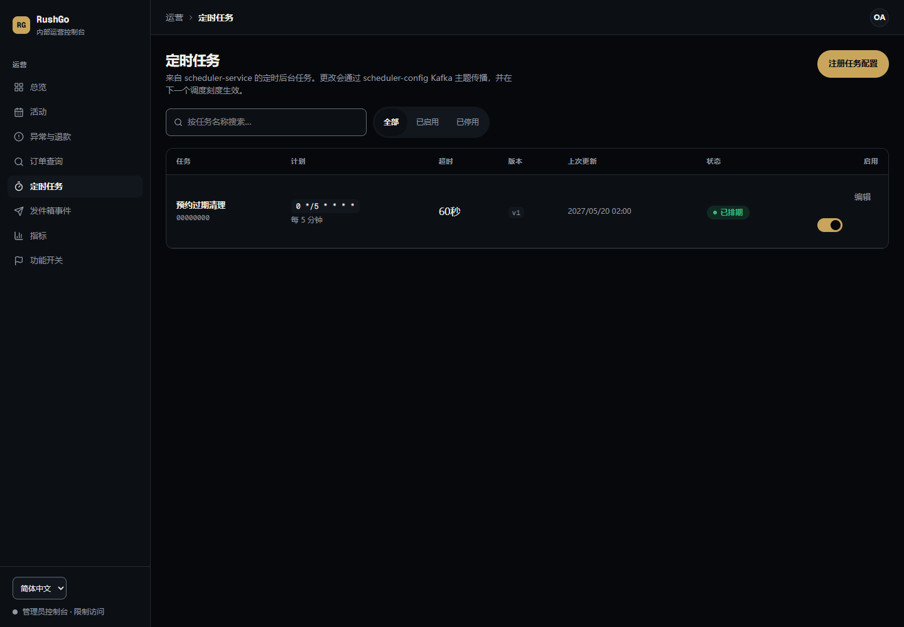

### 功能开关

`/admin/flags` · 管理员 · [页面源码](../frontend/app/admin/flags/page.tsx)

查看允许列表中的展示功能设置和变更记录。

- 读取活动发现高级筛选开关
- 显示数据源与观测时间
- 查看近期审计记录

**截图说明**　本地合成数据。公开活动发现高级筛选已停用；没有历史变更记录。

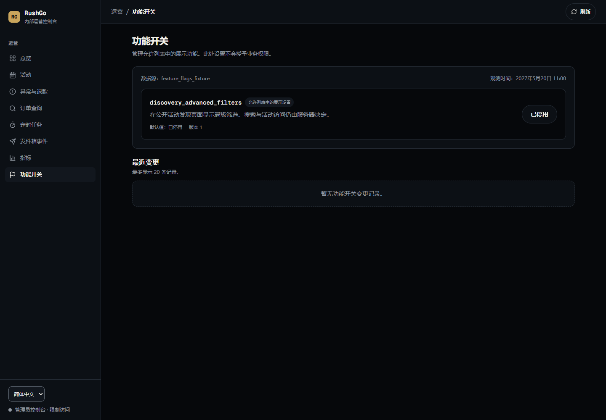

### 运营指标

`/admin/metrics` · 管理员 · [页面源码](../frontend/app/admin/metrics/page.tsx)

在限定时间范围内查看订单、票务、退款和付款汇总。

- 分别标记 Booking 和 Payment 数据源
- 按币种及 TEST 模式呈现已知金额
- 应用范围并导出 CSV

**截图说明**　本地合成数据。时间范围内记录 2 笔订单、1 张已签发票券和 1 笔 48 美元 TEST 收款；一笔退款申请待处理。

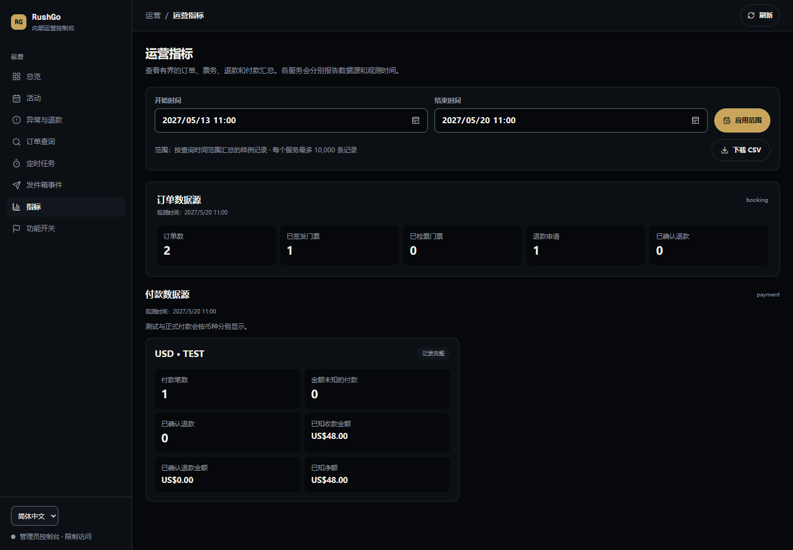

## 移动端

三个窄屏样例使用相同组件和数据，可以比较导航、活动信息和票据操作在手机上的排列。

### 活动发现

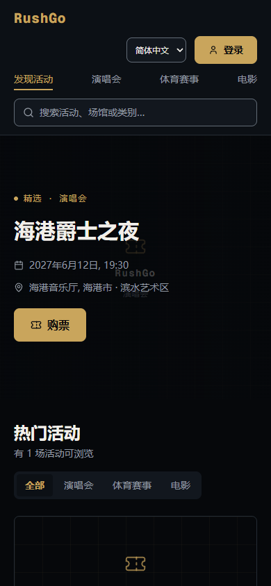

### 活动详情

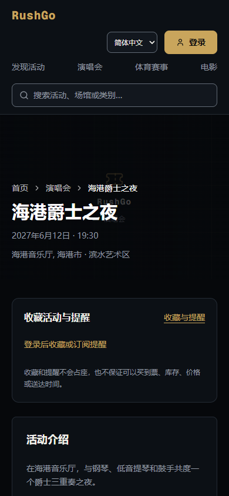

### 我的票券

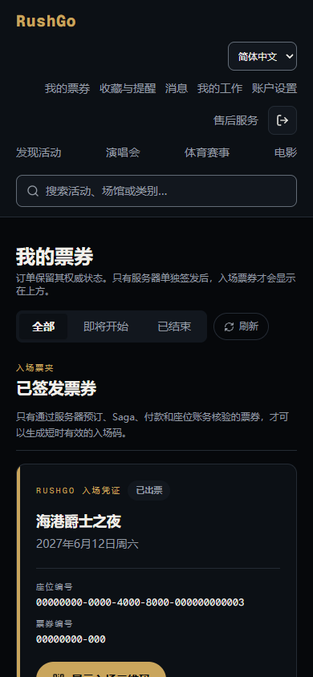
